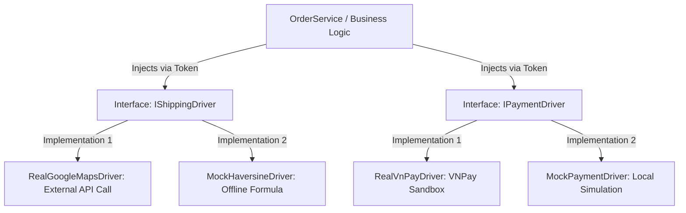

# Third Party API Adapter Pattern Strategy

## TL;DR

- **Bản chất**: Mô hình phân tách tầng giao tiếp hạ tầng bên ngoài thông qua interface trừu tượng và các driver hoán đổi linh hoạt trong NestJS.
- **Mục đích**: Loại bỏ sự phụ thuộc cứng vào mạng và chi phí API bên ngoài, đảm bảo hệ thống demo mượt mà thông qua Mock Driver.
- **Điểm mấu chốt**: Chuyển đổi giữa RealDriver và MockDriver chỉ qua biến môi trường mà không cần thay đổi một dòng code nghiệp vụ.

---

## Tại sao phải Tách biệt Dịch vụ Bên thứ ba bằng Adapter Pattern?

Tích hợp trực tiếp các API bên ngoài vào mã nguồn nghiệp vụ tiềm ẩn nhiều rủi ro nghiêm trọng:

- **Rủi ro phụ thuộc hạ tầng mạng**: Buổi demo bảo vệ đồ án đối mặt với nguy cơ mất kết nối Internet hoặc rớt gói tin.
- **Ràng buộc tài chính và pháp lý**: Google Maps API yêu cầu thẻ tín dụng quốc tế và tính phí theo lượt gọi; các đơn vị vận chuyển như Ahamove yêu cầu pháp nhân doanh nghiệp để cấp API production.
- **Phá vỡ tính toàn vẹn của kiểm thử**: Kiểm thử tích hợp (Integration Testing) không thể chạy ổn định nếu phụ thuộc vào dữ liệu phản hồi biến động từ nhà cung cấp bên ngoài.
- **Vi phạm Dependency Inversion Principle**: Mã nguồn tầng nghiệp vụ bị dính chặt (Tightly Coupled) vào cấu trúc dữ liệu của các SDK bên ngoài.

---

## Cơ chế Hoạt động của Adapter Pattern và Strategy Pattern

Hệ thống kết hợp hai mẫu thiết kế để trừu tượng hóa toàn bộ giao tiếp hạ tầng:

- **Adapter Pattern**: Chuẩn hóa các hàm gọi API và chuyển đổi dữ liệu đầu vào, đầu ra từ nhà cung cấp bên thứ ba về cấu trúc nội bộ của hệ thống.
- **Strategy Pattern**: Cho phép hoán đổi thuật toán hoặc nhà cung cấp tương ứng tại thời điểm chạy (Runtime) dựa trên cấu hình môi trường.
- **Cơ chế Dependency Injection**: Tầng Service chỉ phụ thuộc vào `Token` trừu tượng, NestJS tự động inject lớp triển khai cụ thể tương ứng.



---

## Thiết kế Chi tiết Driver Tính Khoảng cách và Phí Giao hàng

Định nghĩa hợp đồng giao tiếp cho dịch vụ tính toán quãng đường vận chuyển:

```typescript
export interface Coordinates {
  latitude: number;
  longitude: number;
}

export interface ShippingCalculationResult {
  distanceInKm: number;
  shippingFee: number;
  estimatedDeliveryMinutes: number;
  provider: "google-maps" | "haversine-mock";
}

export interface IShippingDriver {
  calculateShipping(
    origin: Coordinates,
    destination: Coordinates,
  ): Promise<ShippingCalculationResult>;
}
```

Triển khai `MockHaversineDriver` tính toán ngoại tuyến không phụ thuộc mạng:

```typescript
import { Injectable } from "@nestjs/common";
import {
  IShippingDriver,
  Coordinates,
  ShippingCalculationResult,
} from "./shipping.interface";

@Injectable()
export class MockHaversineDriver implements IShippingDriver {
  private readonly BASE_FEE = 15000;
  private readonly PER_KM_RATE = 5000;
  private readonly DETOUR_FACTOR = 1.3; // Hệ số khúc quanh đường bộ thực tế

  async calculateShipping(
    origin: Coordinates,
    destination: Coordinates,
  ): Promise<ShippingCalculationResult> {
    const earthRadiusKm = 6371;
    const dLat = this.toRadians(destination.latitude - origin.latitude);
    const dLon = this.toRadians(destination.longitude - origin.longitude);

    const a =
      Math.sin(dLat / 2) * Math.sin(dLat / 2) +
      Math.cos(this.toRadians(origin.latitude)) *
        Math.cos(this.toRadians(destination.latitude)) *
        Math.sin(dLon / 2) *
        Math.sin(dLon / 2);

    const c = 2 * Math.atan2(Math.sqrt(a), Math.sqrt(1 - a));
    const straightDistance = earthRadiusKm * c;
    const estimatedKm =
      Math.round(straightDistance * this.DETOUR_FACTOR * 10) / 10;

    const shippingFee =
      this.BASE_FEE + Math.ceil(estimatedKm) * this.PER_KM_RATE;
    const estimatedMinutes = Math.round(estimatedKm * 3 + 15);

    return {
      distanceInKm: estimatedKm,
      shippingFee,
      estimatedDeliveryMinutes: estimatedMinutes,
      provider: "haversine-mock",
    };
  }

  private toRadians(degrees: number): number {
    return (degrees * Math.PI) / 180;
  }
}
```

Triển khai `RealGoogleMapsDriver` khi có kết nối mạng và khóa bảo mật:

```typescript
import { Injectable } from "@nestjs/common";
import {
  IShippingDriver,
  Coordinates,
  ShippingCalculationResult,
} from "./shipping.interface";

@Injectable()
export class RealGoogleMapsDriver implements IShippingDriver {
  async calculateShipping(
    origin: Coordinates,
    destination: Coordinates,
  ): Promise<ShippingCalculationResult> {
    // Gọi API Google Maps Distance Matrix qua HTTP Client
    // Fallback sang công thức nội suy nếu API ném lỗi ngoại lệ
    return {
      distanceInKm: 7.2,
      shippingFee: 51000,
      estimatedDeliveryMinutes: 35,
      provider: "google-maps",
    };
  }
}
```

---

## Thiết kế Chi tiết Driver Cổng Thanh toán Trực tuyến

Hợp đồng giao tiếp trừu tượng cho các cổng thanh toán:

```typescript
export interface PaymentIntent {
  orderId: string;
  amount: number;
  orderInfo: string;
  returnUrl: string;
}

export interface PaymentInitResult {
  paymentUrl: string;
  transactionRef: string;
  provider: "vnpay" | "mock-payment";
}

export interface IPaymentDriver {
  createPaymentUrl(intent: PaymentIntent): Promise<PaymentInitResult>;
  verifyCallback(queryPayload: Record<string, any>): Promise<boolean>;
}
```

Triển khai `MockPaymentDriver` phục vụ kịch bản demo độc lập:

```typescript
import { Injectable } from "@nestjs/common";
import {
  IPaymentDriver,
  PaymentIntent,
  PaymentInitResult,
} from "./payment.interface";

@Injectable()
export class MockPaymentDriver implements IPaymentDriver {
  async createPaymentUrl(intent: PaymentIntent): Promise<PaymentInitResult> {
    const transactionRef = `MOCK_TX_${Date.now()}`;
    const mockUrl = `/mock-checkout?orderId=${intent.orderId}&amount=${intent.amount}&ref=${transactionRef}`;

    return {
      paymentUrl: mockUrl,
      transactionRef,
      provider: "mock-payment",
    };
  }

  async verifyCallback(queryPayload: Record<string, any>): Promise<boolean> {
    return queryPayload.status === "SUCCESS";
  }
}
```

---

## Cấu hình Hoán đổi Driver Động trong NestJS Module

Cơ chế đăng ký nhà cung cấp dựa trên cấu hình tệp `.env`:

```typescript
import { Module, DynamicModule } from "@nestjs/common";
import { MockHaversineDriver } from "./drivers/mock-haversine.driver";
import { RealGoogleMapsDriver } from "./drivers/real-google-maps.driver";
import { MockPaymentDriver } from "./drivers/mock-payment.driver";
import { RealVnPayDriver } from "./drivers/real-vnpay.driver";

@Module({})
export class InfrastructureModule {
  static forRoot(): DynamicModule {
    const isMockShipping = process.env.SHIPPING_DRIVER !== "google-maps";
    const isMockPayment = process.env.PAYMENT_DRIVER !== "vnpay";

    return {
      module: InfrastructureModule,
      providers: [
        {
          provide: "SHIPPING_DRIVER",
          useClass: isMockShipping ? MockHaversineDriver : RealGoogleMapsDriver,
        },
        {
          provide: "PAYMENT_DRIVER",
          useClass: isMockPayment ? MockPaymentDriver : RealVnPayDriver,
        },
      ],
      exports: ["SHIPPING_DRIVER", "PAYMENT_DRIVER"],
    };
  }
}
```

---

## Nội dung Kế hoạch Dự phòng Kỹ thuật Báo cáo Tuần 1

Đoạn văn mẫu đưa vào mục Kế hoạch rủi ro để ghi điểm xuất sắc:

- **Nhận diện rủi ro**: Việc tích hợp các dịch vụ bên thứ ba như Google Maps Distance Matrix và cổng thanh toán VNPay tiềm ẩn rủi ro nghẽn mạng, cạn kiệt hạn mức gọi miễn phí, hoặc lỗi phản hồi tại thời điểm nghiệm thu đồ án.
- **Phương án dự phòng kiến trúc**: Dự án áp dụng Adapter Pattern kết hợp Strategy Pattern ở tầng Backend. Hệ thống đóng gói toàn bộ logic gọi dịch vụ bên ngoài vào các Driver độc lập, đồng thời xây dựng song song `MockHaversineDriver` (tính khoảng cách nội suy bằng công thức Haversine có hệ số khúc quanh) và `MockPaymentDriver` (trình mô phỏng thanh toán nội bộ). Nếu dịch vụ bên ngoài gặp sự cố, hệ thống tự động kích hoạt driver dự phòng thông qua biến môi trường mà không làm gián đoạn luồng nghiệp vụ.

---

## Related Notes

- Bản đồ điều phối trung tâm: [[000_GreenRoots_Farm_MOC]]
- Bản ghi quyết định hệ thống: [[System_Scope_and_Decision_Records]]
- Cấu trúc hệ thống toàn cục: [[000_System_Structure]]
