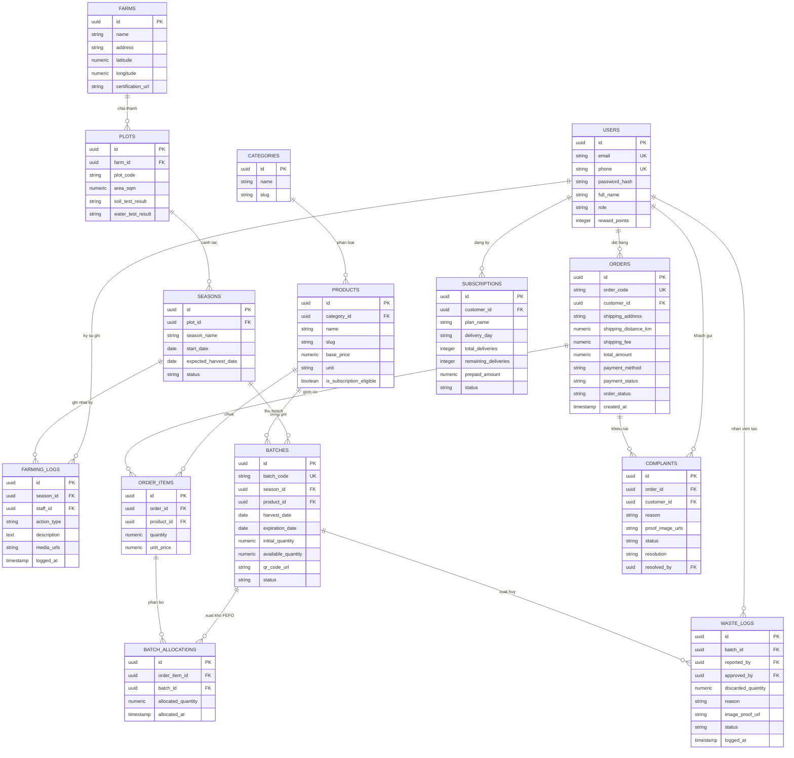

# Database ERD and Data Dictionary

## TL;DR

- **Bản chất**: Tài liệu đặc tả 14 thực thể cơ sở dữ liệu quan hệ và từ điển dữ liệu chuẩn hóa của dự án GreenRoots Farm.
- **Mục đích**: Cung cấp tài liệu thiết kế chuẩn để thành viên BA vẽ biểu đồ ERD và đội ngũ kỹ sư triển khai Drizzle Schema.
- **Điểm mấu chốt**: Liên kết chặt chẽ giữa Lô hàng, phân bổ FEFO (batch_allocations), nhật ký canh tác bất biến và phiếu xuất hủy hai bước.

---

## 1. Sơ Đồ Quan Hệ Thực Thể

Dưới đây là sơ đồ quan hệ thực thể toàn diện bao phủ toàn bộ 14 bảng dữ liệu của hệ thống:

---

## 2. Từ Điển Dữ Liệu Chi Tiết

Bảng đối chiếu 14 thực thể theo 4 phân vùng nghiệp vụ chính:

### Phân vùng 1: Farm Operations

| Tên Bảng       | Khóa Chính  | Khóa Ngoại                      | Các Cột Thuộc Tính Trọng Tâm                                              | Ràng Buộc Nghiệp Vụ                  |
| :------------- | :---------- | :------------------------------ | :------------------------------------------------------------------------ | :----------------------------------- |
| `farms`        | `id` (UUID) | Không                           | `name`, `address`, `latitude`, `longitude`, `certification_url`           | Tọa độ dùng để tính phí ship nội suy |
| `plots`        | `id` (UUID) | `farm_id` $\rightarrow$ `farms` | `plot_code` (Lô đất), `area_sqm`, `soil_test_result`, `water_test_result` | 1 Farm có nhiều Plot đất             |
| `seasons`      | `id` (UUID) | `plot_id` $\rightarrow$ `plots` | `season_name`, `start_date`, `expected_harvest_date`, `status`            | Quản lý vòng đời gieo trồng          |
| `farming_logs` | `id` (UUID) | `season_id`, `staff_id`         | `action_type`, `description`, `media_urls`, `logged_at`                   | **Append-only log** (Không sửa/xóa)  |

### Phân vùng 2: Catalog & Batch Inventory

| Tên Bảng     | Khóa Chính  | Khóa Ngoại                               | Các Cột Thuộc Tính Trọng Tâm                                                                                       | Ràng Buộc Nghiệp Vụ                                |
| :----------- | :---------- | :--------------------------------------- | :----------------------------------------------------------------------------------------------------------------- | :------------------------------------------------- |
| `categories` | `id` (UUID) | Không                                    | `name`, `slug`                                                                                                     | Phân loại rau lá, rau củ quả, gia vị               |
| `products`   | `id` (UUID) | `category_id`                            | `name`, `slug`, `base_price`, `unit`, `is_subscription_eligible`                                                   | Sản phẩm hiển thị trên Storefront                  |
| `batches`    | `id` (UUID) | `season_id`, `product_id`                | `batch_code`, `harvest_date`, `expiration_date`, `initial_quantity`, `available_quantity`, `qr_code_url`, `status` | **Cốt lõi FEFO & QR Code**. 1 sản phẩm có nhiều Lô |
| `waste_logs` | `id` (UUID) | `batch_id`, `reported_by`, `approved_by` | `discarded_quantity`, `reason`, `image_proof_url`, `status`, `logged_at`                                           | Phiếu xuất hủy 2 bước (Staff tạo, Admin duyệt)     |

### Phân vùng 3: Users & Orders

| Tên Bảng            | Khóa Chính  | Khóa Ngoại                  | Các Cột Thuộc Tính Trọng Tâm                                                                                                                 | Ràng Buộc Nghiệp Vụ                             |
| :------------------ | :---------- | :-------------------------- | :------------------------------------------------------------------------------------------------------------------------------------------- | :---------------------------------------------- |
| `users`             | `id` (UUID) | Không                       | `email`, `phone`, `password_hash`, `full_name`, `role`, `reward_points`                                                                      | Phân quyền 5 vai trò; tích lũy 1% điểm          |
| `orders`            | `id` (UUID) | `customer_id`               | `order_code`, `shipping_address`, `shipping_distance_km`, `shipping_fee`, `total_amount`, `payment_method`, `payment_status`, `order_status` | FSM trạng thái đơn hàng                         |
| `order_items`       | `id` (UUID) | `order_id`, `product_id`    | `quantity`, `unit_price`                                                                                                                     | Mỗi dòng sản phẩm trong đơn                     |
| `batch_allocations` | `id` (UUID) | `order_item_id`, `batch_id` | `allocated_quantity`, `allocated_at`                                                                                                         | **Phân bổ FEFO**: 1 item có thể trừ từ nhiều Lô |

### Phân vùng 4: Subscription & Complaints

| Tên Bảng        | Khóa Chính  | Khóa Ngoại                               | Các Cột Thuộc Tính Trọng Tâm                                                                        | Ràng Buộc Nghiệp Vụ                        |
| :-------------- | :---------- | :--------------------------------------- | :-------------------------------------------------------------------------------------------------- | :----------------------------------------- |
| `subscriptions` | `id` (UUID) | `customer_id`                            | `plan_name`, `delivery_day`, `total_deliveries`, `remaining_deliveries`, `prepaid_amount`, `status` | Gói rau định kỳ trả trước                  |
| `complaints`    | `id` (UUID) | `order_id`, `customer_id`, `resolved_by` | `reason`, `proof_image_urls`, `status`, `resolution`                                                | Báo rau dập nát trong 24h kèm tối đa 3 ảnh |

---

## 3. Hướng Dẫn Nhanh Cho Thành Viên Thiết Kế

1. **Công cụ khuyên dùng**: Truy cập <https://draw.io> hoặc <https://mermaid.live>.
2. **Cách vẽ tức thì trong 3 giây trên Draw.io**:
   - Mở file mới trên `draw.io`.
   - Chọn menu **Arrange** $\rightarrow$ **Insert** $\rightarrow$ **Advanced** $\rightarrow$ **Mermaid**.
   - Dán toàn bộ khối mã Mermaid ở Mục 1 vào hộp thoại $\rightarrow$ Bấm **Insert**.
   - `draw.io` sẽ tự động dựng toàn bộ 14 bảng quan hệ đẹp tăm tắp, chỉ cần kéo thả lại layout cho vừa mắt rồi xuất ảnh PNG độ nét cao đưa vào Word!

---

## Related Notes

- Bản đồ dự án: [[000_GreenRoots_Farm_MOC]]
- Báo cáo hoàn chỉnh Chương 1: [[Chapter_01_Project_Initiation_Report]]
- Quyết định kiến trúc hệ thống: [[System_Scope_and_Decision_Records]]
- Đặc tả User Stories MoSCoW: [[MoSCoW_User_Stories_Specification]]
- Lộ trình khởi tạo dự án: [[Project_Initiation_and_Execution_Roadmap]]
- Cấu trúc hệ thống toàn cục: [[000_System_Structure]]
