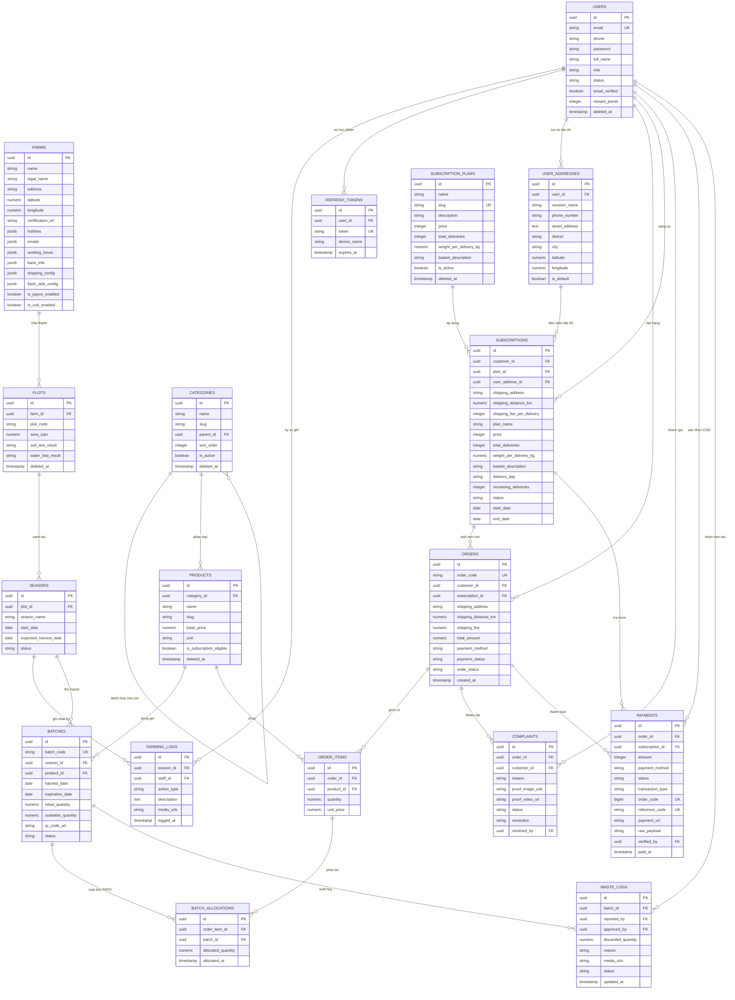

# Database ERD and Data Dictionary

## TL;DR

- **Bản chất**: Tài liệu đặc tả 18 thực thể cơ sở dữ liệu quan hệ và từ điển dữ liệu chuẩn hóa của dự án GreenRoots Farm.
- **Mục đích**: Cung cấp tài liệu thiết kế chuẩn để thành viên BA vẽ biểu đồ ERD và đội ngũ kỹ sư triển khai Drizzle Schema.
- **Điểm mấu chốt**: Liên kết chặt chẽ giữa Lô hàng, phân bổ FEFO, gói định kỳ bất biến (Dual Snapshot-Ref) và phiếu xuất hủy hai bước.

---

## 1. Sơ Đồ Quan Hệ Thực Thể

Dưới đây là sơ đồ quan hệ thực thể toàn diện bao phủ toàn bộ 18 bảng dữ liệu của hệ thống:



---

## 2. Từ Điển Dữ Liệu Chi Tiết

Bảng đối chiếu 18 thực thể theo 4 phân vùng nghiệp vụ chính:

### Phân vùng 1: Farm Operations

| Tên Bảng       | Khóa Chính  | Khóa Ngoại                      | Các Cột Thuộc Tính Trọng Tâm                                                                                                     | Ràng Buộc Nghiệp Vụ                                                    |
| :------------- | :---------- | :------------------------------ | :------------------------------------------------------------------------------------------------------------------------------- | :--------------------------------------------------------------------- |
| `farms`        | `id` (UUID) | Không                           | `name`, `legal_name`, `address`, `latitude`, `longitude`, `hotlines`, `shipping_config`, `flash_sale_config`, `is_payos_enabled` | Singleton cấu hình nông trại & cache Redis 24h (không chứa API secret) |
| `plots`        | `id` (UUID) | `farm_id` $\rightarrow$ `farms` | `plot_code` (Lô đất), `area_sqm`, `soil_test_result`, `water_test_result`, `deleted_at`                                          | 1 Farm có nhiều Plot đất; Soft delete kèm Partial Unique Index         |
| `seasons`      | `id` (UUID) | `plot_id` $\rightarrow$ `plots` | `season_name`, `start_date`, `expected_harvest_date`, `status`                                                                   | Quản lý vòng đời gieo trồng                                            |
| `farming_logs` | `id` (UUID) | `season_id`, `staff_id`         | `action_type`, `description`, `media_urls`, `logged_at`                                                                          | **Append-only log** (Không sửa/xóa)                                    |

### Phân vùng 2: Catalog & Batch Inventory

| Tên Bảng     | Khóa Chính  | Khóa Ngoại                               | Các Cột Thuộc Tính Trọng Tâm                                                                                       | Ràng Buộc Nghiệp Vụ                                        |
| :----------- | :---------- | :--------------------------------------- | :----------------------------------------------------------------------------------------------------------------- | :--------------------------------------------------------- |
| `categories` | `id` (UUID) | `parent_id` $\rightarrow$ `categories`   | `name`, `slug`, `parent_id`, `sort_order`, `is_active`, `deleted_at`                                               | Phân loại đa cấp; `is_active` tạm ẩn, `deleted_at` xóa mềm |
| `products`   | `id` (UUID) | `category_id`                            | `name`, `slug`, `base_price`, `unit`, `is_subscription_eligible`, `deleted_at`                                     | Sản phẩm Storefront; Soft delete giữ lịch sử `order_items` |
| `batches`    | `id` (UUID) | `season_id`, `product_id`                | `batch_code`, `harvest_date`, `expiration_date`, `initial_quantity`, `available_quantity`, `qr_code_url`, `status` | **Cốt lõi FEFO & QR Code**. 1 sản phẩm có nhiều Lô         |
| `waste_logs` | `id` (UUID) | `batch_id`, `reported_by`, `approved_by` | `discarded_quantity`, `reason`, `media_urls`, `status`, `updated_at`                                               | Phiếu xuất hủy 2 bước (Staff tạo, Admin duyệt)             |

### Phân vùng 3: Users & Orders

| Tên Bảng            | Khóa Chính  | Khóa Ngoại                       | Các Cột Thuộc Tính Trọng Tâm                                                                                                                                    | Ràng Buộc Nghiệp Vụ                                      |
| :------------------ | :---------- | :------------------------------- | :-------------------------------------------------------------------------------------------------------------------------------------------------------------- | :------------------------------------------------------- |
| `users`             | `id` (UUID) | Không                            | `email`, `phone`, `password`, `full_name`, `role`, `status`, `email_verified`, `reward_points`, `deleted_at`                                                    | Phân quyền 6 vai trò; Soft delete + Partial Unique Index |
| `refresh_tokens`    | `id` (UUID) | `user_id` $\rightarrow$ `users`  | `token`, `device_name`, `ip_address`, `expires_at`                                                                                                              | **Phiên đăng nhập bền vững**: ACID xoay vòng token       |
| `user_addresses`    | `id` (UUID) | `user_id` $\rightarrow$ `users`  | `receiver_name`, `phone_number`, `street_address`, `district`, `city`, `latitude`, `longitude`, `is_default`                                                    | Sổ địa chỉ khách hàng; tọa độ tính ship Haversine        |
| `orders`            | `id` (UUID) | `customer_id`, `subscription_id` | `order_code`, `subscription_id`, `shipping_address`, `shipping_distance_km`, `shipping_fee`, `total_amount`, `payment_method`, `payment_status`, `order_status` | FSM trạng thái đơn; đơn con liên kết gói                 |
| `order_items`       | `id` (UUID) | `order_id`, `product_id`         | `quantity`, `unit_price`                                                                                                                                        | Mỗi dòng sản phẩm trong đơn                              |
| `batch_allocations` | `id` (UUID) | `order_item_id`, `batch_id`      | `allocated_quantity`, `allocated_at`                                                                                                                            | **Phân bổ FEFO**: 1 item có thể trừ từ nhiều Lô          |

### Phân vùng 4: Subscription, Payments & Complaints

| Tên Bảng             | Khóa Chính  | Khóa Ngoại                                   | Các Cột Thuộc Tính Trọng Tâm                                                                                                                                        | Ràng Buộc Nghiệp Vụ                                                              |
| :------------------- | :---------- | :------------------------------------------- | :------------------------------------------------------------------------------------------------------------------------------------------------------------------ | :------------------------------------------------------------------------------- |
| `subscription_plans` | `id` (UUID) | Không                                        | `name`, `slug`, `description`, `price`, `total_deliveries`, `weight_per_delivery_kg`, `basket_description`, `is_active`, `deleted_at`                               | Gói rau định kỳ; `is_active` tạm ngưng, `deleted_at` xóa mềm                     |
| `subscriptions`      | `id` (UUID) | `customer_id`, `plan_id`, `user_address_id`  | `plan_name`, `price`, `total_deliveries`, `shipping_address`, `shipping_distance_km`, `shipping_fee_per_delivery`, `delivery_day`, `remaining_deliveries`, `status` | **Dual Ref-Snapshot & Full Address**: Đảm bảo Cron Job tự động giao đúng địa chỉ |
| `complaints`         | `id` (UUID) | `order_id`, `customer_id`, `resolved_by`     | `reason`, `proof_image_urls`, `proof_video_url`, `status`, `resolution`                                                                                             | Báo rau dập nát: Bắt buộc 1-5 ảnh, video tùy chọn (<=15s, <=15MB)                |
| `payments`           | `id` (UUID) | `order_id`, `subscription_id`, `verified_by` | `amount`, `payment_method`, `status`, `transaction_type`, `order_code`, `reference_code`, `payment_url`, `raw_payload`, `paid_at`                                   | **Sổ cái thanh toán hợp nhất**: Tích hợp PayOS Webhook, đối soát & hoàn tiền     |

---

## 3. Hướng Dẫn Nhanh Cho Thành Viên Thiết Kế

1. **Vẽ tức thì trên dbdiagram.io**:
   - Mở <https://dbdiagram.io>.
   - Copy toàn bộ mã nguồn file `Database_Schema.dbml` dán vào khung soạn thảo bên trái.
   - dbdiagram.io sẽ tự động vẽ toàn bộ 18 thực thể, quan hệ 1-N, N-N, các kiểu enum và chỉ mục Indexes đẹp mắt.

   - Mở file mới trên <https://draw.io>.
   - Chọn menu **Arrange** $\rightarrow$ **Insert** $\rightarrow$ **Advanced** $\rightarrow$ **Mermaid**.
   - Dán toàn bộ khối mã Mermaid ở Mục 1 vào hộp thoại $\rightarrow$ Bấm **Insert**.

---

## 4. Đặc Tả Khóa Bất Biến và Cấu Trúc JSONB

### Kịch bản Trigger bảo vệ Nhật ký canh tác (PostgreSQL Engine)

Kịch bản migration kích hoạt cơ chế Append-Only, ngăn chặn tuyệt đối thao tác sửa và xóa:

```sql
CREATE OR REPLACE FUNCTION prevent_farming_log_mutation()
RETURNS TRIGGER AS $$
BEGIN
  RAISE EXCEPTION 'FARMING_LOG_IMMUTABLE: Nghiem cam UPDATE hoac DELETE nhat ky canh tac!';
END;
$$ LANGUAGE plpgsql;

CREATE TRIGGER trg_immutable_farming_logs
BEFORE UPDATE OR DELETE ON farming_logs
FOR EACH ROW
EXECUTE FUNCTION prevent_farming_log_mutation();
```

### Hợp đồng dữ liệu JSONB (JSON Data Contracts)

Đặc tả cấu trúc kiểu dữ liệu TypeScript dùng chung cho các cột JSONB:

| Bảng           | Cột JSONB                               | TypeScript Type Contract                                                                                                                                                                                   | Ràng buộc nghiệp vụ                                                                          |
| :------------- | :-------------------------------------- | :--------------------------------------------------------------------------------------------------------------------------------------------------------------------------------------------------------- | :------------------------------------------------------------------------------------------- |
| `plots`        | `soil_test_result`                      | `{ ph: number; nitrogen_ppm: number; phosphorus_ppm: number; potassium_ppm: number; heavy_metals: { lead_ppm: number; cadmium_ppm: number; pass: boolean }; tested_at: string; certificate_url?: string }` | Báo cáo xét nghiệm khoáng chất và kim loại nặng định kỳ                                      |
| `plots`        | `water_test_result`                     | `{ ph: number; ec_ms_cm: number; dissolved_oxygen_ppm: number; e_coli_cfu_100ml: number; heavy_metals_pass: boolean; tested_at: string; certificate_url?: string }`                                        | Chỉ số hóa lý và vi sinh nguồn nước tưới tiêu                                                |
| `farming_logs` | `media_urls`                            | `string[]`                                                                                                                                                                                                 | Tối đa 3 URLs Cloudinary, video $\le 15$s ($\le 15$MB), ảnh $\le 300$KB                      |
| `products`     | `image_urls`                            | `string[]`                                                                                                                                                                                                 | Tối đa 5 URLs Cloudinary ảnh sản phẩm giới thiệu trên Storefront                             |
| `waste_logs`   | `media_urls`                            | `string[]`                                                                                                                                                                                                 | Bắt buộc 1-3 URLs Cloudinary (ảnh $\le 300$KB hoặc video $\le 15$s/15MB) bằng chứng hủy hàng |
| `complaints`   | `proof_image_urls`                      | `string[]`                                                                                                                                                                                                 | Bắt buộc 1-5 ảnh chụp tem QR và phần dập nát, $\le 1$MB/ảnh                                  |
| `payments`     | `raw_payload`                           | `Record<string, unknown>`                                                                                                                                                                                  | Lưu nguyên vẹn body Webhook từ PayOS phục vụ đối soát                                        |
| `farms`        | `hotlines` / `emails` / `working_hours` | `{ primary: string; support?: string }` / `{ weekdays: string; weekend: string }`                                                                                                                          | Thông tin liên hệ hiển thị công khai trên Storefront và phiếu giao hàng                      |
| `farms`        | `bank_info`                             | `{ bankName: string; accountNumber: string; accountHolder: string }`                                                                                                                                       | Tài khoản thụ hưởng công khai; khóa bí mật PayOS giữ tuyệt đối trong `.env`                  |
| `farms`        | `shipping_config` / `flash_sale_config` | `{ baseFeeVnd: number; freeKmThreshold: number; perKmRateVnd: number; detourFactor: number }` / `{ hoursThreshold: number; discountPercent: number }`                                                      | Tham số vận hành động do SuperAdmin tinh chỉnh trên `BO-10`                                  |

---

## Related Notes

- Bản đồ dự án: [[000_GreenRoots_Farm_MOC]]
- Báo cáo hoàn chỉnh Chương 1: [[Chapter_01_Project_Initiation_Report]]
- Quyết định kiến trúc hệ thống: [[System_Scope_and_Decision_Records]]
- Đặc tả User Stories MoSCoW: [[MoSCoW_User_Stories_Specification]]
- Lộ trình khởi tạo dự án: [[Project_Initiation_and_Execution_Roadmap]]
- Cấu trúc hệ thống toàn cục: [[000_System_Structure]]
