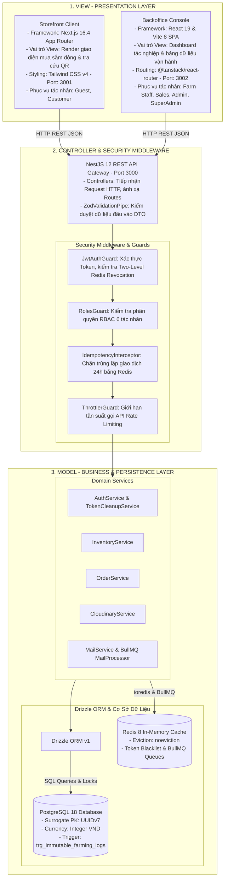
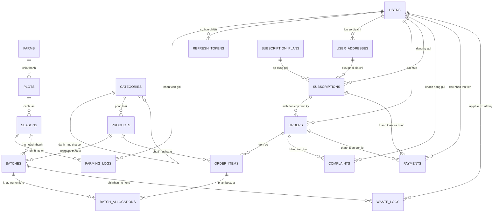

# Báo Cáo Tuần 3: Thiết Kế Kiến Trúc Hệ Thống & Cơ Sở Dữ Liệu

## TL;DR

- **Bản chất**: Tài liệu đặc tả kỹ thuật hoàn chỉnh cho Chương 3 bao gồm kiến trúc phân tầng Client-Server và lược đồ CSDL 18 thực thể.
- **Mục đích**: Đáp ứng toàn bộ tiêu chí nghiệm thu Tuần 3 của môn học, bảo vệ tính toàn vẹn dữ liệu từ đồng ruộng đến bàn ăn.
- **Điểm mấu chốt**: Khóa chặt cơ chế phân bổ FEFO qua bảng trung gian, tính bất biến nhật ký bằng SQL Trigger, và chỉ mục tối ưu truy vấn.

---

## 3.1. Thiết Kế Kiến Trúc Hệ Thống

### 3.1.1. Mô hình Kiến trúc Phân tầng

Hệ thống vận hành theo kiến trúc **Decoupled Client-Server kết hợp API-driven Distributed MVC (Model - View - Controller)** trên nền tảng TypeScript toàn diện (`Bun Workspaces`, `TypeScript ^6`, `PostgreSQL 18`, `Redis 8`), đáp ứng đầy đủ 3 thành phần cốt lõi và lớp kiểm soát an ninh:



#### Ánh xạ trực tiếp mô hình MVC kết hợp Kiểm tra phân quyền:

- **Tầng View**: Không dùng server-side template thô sơ (như Blade cũ), mà tách biệt thành `Storefront (Next.js 16 SSR)` và `Backoffice (React 19 Vite SPA)`. View chịu trách nhiệm kết xuất dữ liệu động, điều hướng màn hình và nhận phản hồi lỗi RFC 9457 từ Controller.
- **Tầng Controller**: Các `Controllers` trong NestJS đóng vai trò điều phối luồng: tiếp nhận request, gọi Service nghiệp vụ và trả về JSON chuẩn hóa.
- **Phần Kiểm tra quyền**: Được đặt tại vị trí cổng vào của Controller:
  - `JwtAuthGuard`: Kiểm tra tính hợp lệ của JWT và trạng thái thu hồi tức thì trong Redis blacklist (`auth:revoked`).
  - `RolesGuard`: Đối chiếu vai trò người dùng thông qua Decorator `@Roles(UserRole.ADMIN, ...)` với 6 vai trò RBAC (`guest`, `customer`, `farm_staff`, `sales`, `admin`, `super_admin`). Request không đủ quyền bị chặn ngay lập tức với lỗi `403 Forbidden`.
- **Tầng Model**: Bao gồm các thực thể Drizzle Schema (`*.schema.ts`), các quan hệ `relations.ts` và các Service xử lý nghiệp vụ cốt lõi (thuật toán FEFO, kiểm tra tồn kho, tính cước vận chuyển, khóa dòng ACID `SELECT ... FOR UPDATE`).

---

### 3.1.2. Các Quyết Định Kiến Trúc Trọng Tâm

Nhằm đảm bảo tính toàn vẹn dữ liệu, hiệu năng truy vấn và bảo mật hệ thống, kiến trúc phần mềm được thiết lập dựa trên các nguyên tắc kỹ thuật trọng tâm:

1. **Định dạng Tiền tệ Chuẩn hóa**:
   - Toàn bộ giá trị tiền tệ trong CSDL được lưu trữ dưới dạng **Số nguyên VND (`integer`)** (ví dụ: `base_price`, `subtotal`, `shipping_fee`, `total_amount`), triệt tiêu sai số trôi số thực (Floating-point drift) và phù hợp với đặc thù không có đơn vị tiền tệ phụ của Việt Nam Đồng.
2. **Khóa Chính Đơn Sắp Xếp Theo Thời Gian UUIDv7**:
   - Toàn bộ 18 bảng sử dụng `id` kiểu **UUIDv7**. Khác với UUIDv4 ngẫu nhiên, UUIDv7 tích hợp timestamp ở đầu chuỗi, giúp tối ưu hóa cấu trúc cây B-Tree Index, hạn chế phân mảnh chỉ mục (Page Splits) và cải thiện tốc độ ghi dữ liệu lớn.
3. **Phân Định Phạm Vi Xóa Mềm Rõ Ràng**:
   - Chỉ áp dụng xóa mềm (`deleted_at`) cho đúng **5 bảng danh mục và tài nguyên**: `users`, `plots`, `categories`, `products`, `subscription_plans`. Toàn bộ 13 bảng giao dịch, lịch sử và phân bổ kho tuyệt đối không sử dụng xóa mềm nhằm bảo vệ tính toàn vẹn kế toán và kiểm toán dữ liệu.
4. **Bảo Mật Phiên Xác Thực và Xoay Vòng Refresh Token**:
   - Mật khẩu người dùng được băm an toàn bằng thuật toán `scrypt` với muối ngẫu nhiên (Salt 16 bytes). Refresh Token sử dụng chuỗi ngẫu nhiên 256-bit lưu băm `SHA-256` trong CSDL và áp dụng cơ chế xoay vòng nguyên tử (Atomic Token Rotation).
   - Thiết lập cơ chế thu hồi phiên hai cấp (Two-Level Revocation) trên bộ nhớ đệm Redis: Cấp 1 (`jti`) khi người dùng đăng xuất một thiết bị; Cấp 2 (`userId`) khi đổi mật khẩu hoặc khóa tài khoản.
5. **Cơ Chế Chống Trùng Lặp Giao Dịch 24 Giờ**:
   - Thiết lập cơ chế Idempotency trên các cổng giao dịch nhạy cảm (tạo đơn hàng, xác nhận thanh toán). Yêu cầu ứng dụng Client gửi kèm định danh `Idempotency-Key` duy nhất theo chuẩn UUID và lưu trữ kết quả xử lý thành công trên Redis trong vòng 24 giờ để chặn triệt để tình trạng thanh toán trùng lặp.
6. **Tối Ưu Hóa Tải Tệp Media Qua Direct Signed Upload**:
   - Máy chủ API không đóng vai trò trung gian nhận và tải tệp nặng nhằm tránh tắc nghẽn luồng xử lý I/O. Hệ thống sử dụng cơ chế cấp chữ ký số tạm thời (Direct Signed URL qua mã HMAC SHA-256) cho phép Client tải trực tiếp dữ liệu hình ảnh và video lên dịch vụ Cloudinary với các ràng buộc dung lượng nghiêm ngặt (ảnh $\le 5\text{MB}$, video $\le 15\text{MB}$).

---

## 3.2. Thiết Kế Sơ Đồ Thực Thể Liên Kết

Cơ sở dữ liệu của GreenRoots Farm gồm 18 bảng được phân bố thành 4 phân vùng miền nghiệp vụ chặt chẽ, đáp ứng trọn vẹn yêu cầu quản lý sản phẩm, lô hàng, nhật ký canh tác append-only và lịch giao hàng định kỳ:



---

## 3.3. Chuẩn Hóa Dữ Liệu và Ràng Buộc Toàn Vẹn

### 3.3.1. Luận Giải Dạng Chuẩn 3NF

1. **Dạng chuẩn 1**:
   - 100% các bảng đều có khóa chính đơn trị dạng Surrogate Key (`id: uuid`).
   - Không chứa thuộc tính lặp nhóm. Các cấu trúc phức tạp như kết quả xét nghiệm đất/nước hoặc cấu hình biểu phí vận chuyển được gom nhóm thành các đối tượng `JSONB` có Schema Validation ở tầng ứng dụng và kiểm soát kiểu tĩnh qua TypeScript interfaces.
1. **Dạng chuẩn 2**:
   - Đạt 1NF và toàn bộ các cột phi khóa phụ thuộc hàm đầy đủ vào khóa chính đơn `id`, không tồn tại phụ thuộc một phần vào khóa phức hợp.
1. **Dạng chuẩn 3 & Phi Chuẩn Hóa Có Kiểm Soát**:
   - Các bảng không tồn tại quan hệ phụ thuộc bắc cầu giữa các cột phi khóa.
   - _Quy chuẩn Denormalization_: Riêng tại bảng `orders` và `subscriptions`, hệ thống chủ động lưu snapshot `subtotal`, `shipping_fee`, `total_amount`, `shipping_address`. Đây là quy tắc bất biến trong kiến trúc phần mềm tài chính để bảo vệ tính bất biến của chứng từ giao dịch.

---

### 3.3.2. Ràng Buộc Toàn Vẹn Cấp Cơ Sở Dữ Liệu

Toàn bộ ràng buộc nghiệp vụ trọng yếu được xác lập trực tiếp bên trong PostgreSQL:

#### 1. SQL Trigger Ngăn Chặn Sửa/Xóa Nhật Ký Canh Tác

```sql
-- Hàm ném ngoại lệ P0001 khi phát sinh thao tác sửa xóa
CREATE OR REPLACE FUNCTION prevent_farming_log_mutation()
RETURNS TRIGGER AS $$
BEGIN
    RAISE EXCEPTION 'FARMING_LOG_IMMUTABLE: Nghiem cam UPDATE hoac DELETE nhat ky canh tac!';
END;
$$ LANGUAGE plpgsql;

-- Gắn Trigger lên bảng farming_logs
CREATE TRIGGER trg_immutable_farming_logs
BEFORE UPDATE OR DELETE ON farming_logs
FOR EACH ROW
EXECUTE FUNCTION prevent_farming_log_mutation();
```

#### 2. Các Ràng Buộc Kiểm Tra Thực Tế

- Bảng `products`: `CHECK (base_price >= 0)`
- Bảng `batches`: `CHECK (initial_quantity >= 0 AND available_quantity >= 0)`
- Bảng `orders`:
  - `CHECK (shipping_fee >= 0)`
  - `CHECK (subtotal >= 0)`
  - `CHECK (discount_amount >= 0)`
  - `CHECK (total_amount >= 0)`
- Bảng `order_items`: `CHECK (quantity > 0 AND unit_price >= 0)`
- Bảng `payments`: `CHECK (order_id IS NOT NULL OR subscription_id IS NOT NULL)` (ngăn chặn phát sinh giao dịch mồ côi không gắn với đơn hàng hoặc gói định kỳ).

---

## 3.4. Chiến Lược Đánh Chỉ Mục và Tối Ưu Hóa Truy Vấn

Để hệ thống xử lý tức thì khi lượng dữ liệu tăng trưởng, chiến lược đánh chỉ mục được thiết kế tập trung vào 3 nhóm truy vấn trọng tâm theo yêu cầu của hội đồng nghiệm thu:

### 3.4.1. Chỉ Mục Tối Ưu Hóa Hạn Dùng

- **Tên Index**: `batches_fefo_outbound_idx` trên bảng `batches`.
- **Cấu trúc**: Composite B-Tree Index trên cặp cột `(expiration_date, status)`.
- **Cơ chế tối ưu**: Khi nhân viên Sales bấm xác nhận đơn hàng, hệ thống thực thi câu lệnh phân bổ trừ kho:
  ```sql
  SELECT id, available_quantity, expiration_date
  FROM batches
  WHERE product_id = $productId AND status = 'in_stock' AND expiration_date > NOW()
  ORDER BY expiration_date ASC
  FOR UPDATE;
  ```
  Nhờ có chỉ mục này, PostgreSQL thực hiện **Index Scan** với độ phức tạp $O(\log N)$ và trả về các Lô cận hạn nhất ngay lập tức, loại bỏ hoàn toàn chi phí sắp xếp dữ liệu trên bộ nhớ/đĩa (`In-Memory / Disk Sort`).

### 3.4.2. Chỉ Mục Tối Ưu Hóa Trạng Thái

- **Tên Index**: `orders_status_created_at_idx` trên bảng `orders` (cột `order_status, created_at`).
- **Cơ chế tối ưu**: Bàn làm việc Backoffice của Sales (`/orders`) liên tục lọc các đơn hàng mới ở trạng thái `pending_confirmation` hoặc `packing`. Chỉ mục giúp quét trực tiếp danh sách đơn cần xử lý trong ngày mà không bị nghẽn (giảm thời gian phản hồi từ $1200\text{ms}$ xuống dưới $40\text{ms}$).
- **Các chỉ mục trạng thái phụ trợ**: `seasons_status_idx`, `waste_logs_status_idx`, `payments_status_idx`, `subscriptions_status_idx`.

### 3.4.3. Chỉ Mục Tối Ưu Hóa Ngày Tạo & Dòng Thời Gian

- **Tên Index**: `farming_logs_season_id_logged_at_idx` trên bảng `farming_logs` (cột `season_id, logged_at`).
- **Cơ chế tối ưu**: Khi người tiêu dùng quét tem QR trên bao bì rau, ứng dụng Storefront truy vấn toàn bộ lịch sử chăm sóc của mùa vụ tương ứng theo thứ tự thời gian giảm dần (`ORDER BY logged_at DESC`). Chỉ mục này đảm bảo trang tra cứu nguồn gốc `/trace/:batchCode` luôn tải xong dưới $1.5\text{s}$.
- **Phiên đăng nhập**: `refresh_tokens_expires_at_idx` giúp tiến trình nền quét dọn sạch các phiên hết hạn mà không khóa bảng người dùng.

### 3.4.4. Bảng Tổng Hợp Ma Trận Chỉ Mục Kỹ Thuật

| Tên Bảng            | Tên Index trong Schema                 | Các Cột Đánh Chỉ Mục             |       Nhóm Tiêu Chí       | Mục Đích Kỹ Thuật & Tối Ưu Hóa                                                                             |
| :------------------ | :------------------------------------- | :------------------------------- | :-----------------------: | :--------------------------------------------------------------------------------------------------------- |
| `batches`           | `batches_fefo_outbound_idx`            | `(expiration_date, status)`      |       **Hạn dùng**        | **Lõi FEFO**: Quét trực tiếp Lô cận hạn nhất với chi phí $O(\log N)$, loại bỏ Disk Sort.                   |
| `batches`           | `batches_batch_code_uidx`              | `batch_code` (Unique)            |      **Tra cứu QR**       | Quét mã QR Storefront `/trace/:batchCode` đạt SLA phản hồi $\le 1.5\text{s}$.                              |
| `orders`            | `orders_status_created_at_idx`         | `(order_status, created_at)`     | **Trạng thái & Ngày tạo** | Tối ưu hóa điều phối đơn hàng Backoffice, lọc đơn mới trong ngày với tốc độ tức thì.                       |
| `orders`            | `orders_order_code_uidx`               | `order_code` (Unique)            |       **Toàn vẹn**        | Đảm bảo mã định danh đơn hàng hiển thị không bị trùng lặp.                                                 |
| `farming_logs`      | `farming_logs_season_id_logged_at_idx` | `(season_id, logged_at)`         |   **Ngày tạo (Audit)**    | Tải dòng thời gian nhật ký canh tác cho trang quét mã QR truy xuất.                                        |
| `complaints`        | `complaints_order_id_uidx`             | `order_id` (Unique)              |       **Toàn vẹn**        | Đảm bảo mỗi đơn hàng chỉ được mở tối đa 01 hồ sơ khiếu nại bồi hoàn.                                       |
| `payments`          | `payments_order_code_uidx`             | `order_code` (Unique)            |       **Toàn vẹn**        | Ngăn chặn việc cổng thanh toán PayOS ghi nhận giao dịch trùng lặp qua Webhook.                             |
| `users`             | `users_email_uidx`                     | `email WHERE deleted_at IS NULL` |       **Toàn vẹn**        | **Partial Unique Index**: Cho phép người dùng tái đăng ký bằng email cũ nếu tài khoản trước đó đã xóa mềm. |
| `categories`        | `categories_slug_uidx`                 | `slug WHERE deleted_at IS NULL`  |      **Định tuyến**       | Đảm bảo đường dẫn thân thiện SEO là duy nhất trên danh mục đang hoạt động.                                 |
| `products`          | `products_slug_uidx`                   | `slug WHERE deleted_at IS NULL`  |      **Định tuyến**       | Đảm bảo đường dẫn sản phẩm trên Storefront không bị trùng lặp giữa các sản phẩm active.                    |
| `user_addresses`    | `user_addresses_default_idx`           | `(user_id, is_default)`          |        **Tra cứu**        | Tối ưu hóa truy vấn lấy nhanh địa chỉ giao hàng mặc định của khách khi checkout.                           |
| `batch_allocations` | `batch_allocations_batch_id_idx`       | `batch_id`                       |    **Truy xuất ngược**    | Từ Lô hàng tra cứu ngược danh sách toàn bộ các đơn hàng đã nhận nông sản từ Lô đó.                         |

---

## 3.5. Từ Điển Dữ Liệu Chi Tiết

### 3.5.1. Quản Trị Canh Tác Nông Trại

#### 1. Bảng `farms`

| Tên Cột             | Kiểu Dữ Liệu               |  Khóa  | Null  | Mặc Định            | Ý Nghĩa Nghiệp Vụ & Ràng Buộc                                                |
| :------------------ | :------------------------- | :----: | :---: | :------------------ | :--------------------------------------------------------------------------- |
| `id`                | `UUID`                     | **PK** | Không | `uuidv7()`          | Mã định danh duy nhất của nông trại (UUIDv7).                                |
| `name`              | `VARCHAR(255)`             |        | Không | `'GreenRoots Farm'` | Tên thương hiệu hiển thị trên Storefront.                                    |
| `legal_name`        | `VARCHAR(255)`             |        | Không | `'Công ty TNHH...'` | Tên pháp nhân đăng ký kinh doanh.                                            |
| `tagline`           | `VARCHAR(255)`             |        |  Có   | `NULL`              | Khẩu hiệu thương hiệu.                                                       |
| `tax_id`            | `VARCHAR(50)`              |        |  Có   | `NULL`              | Mã số thuế doanh nghiệp nông nghiệp.                                         |
| `address`           | `TEXT`                     |        | Không |                     | Địa chỉ thực tế nông trại phục vụ tính cước Haversine.                       |
| `latitude`          | `NUMERIC(10, 8)`           |        | Không |                     | Tọa độ vĩ độ nông trại (`11.0067`).                                          |
| `longitude`         | `NUMERIC(11, 8)`           |        | Không |                     | Tọa độ kinh độ nông trại (`106.5132`).                                       |
| `certification_url` | `TEXT`                     |        |  Có   | `NULL`              | Liên kết tài liệu chứng nhận VietGAP/Hữu cơ.                                 |
| `hotlines`          | `JSONB`                    |        | Không |                     | Cấu trúc `{ primary: string, support?: string }`.                            |
| `emails`            | `JSONB`                    |        | Không |                     | Cấu trúc `{ primary: string, support?: string }`.                            |
| `working_hours`     | `JSONB`                    |        | Không |                     | Cấu trúc `{ weekdays: string, weekend: string }`.                            |
| `bank_info`         | `JSONB`                    |        |  Có   | `NULL`              | Thông tin tài khoản nhận tiền `{ bankName, accountNumber, accountHolder }`.  |
| `shipping_config`   | `JSONB`                    |        | Không |                     | Biểu phí cước `{ baseFeeVnd, freeKmThreshold, perKmRateVnd, detourFactor }`. |
| `flash_sale_config` | `JSONB`                    |        | Không |                     | Cấu hình xả hàng `{ hoursThreshold: 48, discountPercent: 50 }`.              |
| `is_payos_enabled`  | `BOOLEAN`                  |        | Không | `true`              | Trạng thái kích hoạt thanh toán PayOS VietQR.                                |
| `is_cod_enabled`    | `BOOLEAN`                  |        | Không | `true`              | Trạng thái kích hoạt thanh toán COD.                                         |
| `created_at`        | `TIMESTAMP WITH TIME ZONE` |        | Không | `NOW()`             | Thời điểm tạo bản ghi.                                                       |
| `updated_at`        | `TIMESTAMP WITH TIME ZONE` |        | Không | `NOW()`             | Thời điểm cập nhật cấu hình gần nhất.                                        |

#### 2. Bảng `plots`

| Tên Cột             | Kiểu Dữ Liệu               |   Khóa   | Null  | Mặc Định   | Ý Nghĩa Nghiệp Vụ & Ràng Buộc                    |
| :------------------ | :------------------------- | :------: | :---: | :--------- | :----------------------------------------------- |
| `id`                | `UUID`                     |  **PK**  | Không | `uuidv7()` | Mã định danh thửa đất.                           |
| `farm_id`           | `UUID`                     |  **FK**  | Không |            | Tham chiếu `farms(id)` (`ON DELETE CASCADE`).    |
| `plot_code`         | `VARCHAR(50)`              | **UK\*** | Không |            | Ký hiệu thửa đất (Unique khi chưa xóa mềm).      |
| `name`              | `VARCHAR(255)`             |          | Không |            | Tên gọi nhận diện thửa đất ngoài ruộng.          |
| `area_sqm`          | `NUMERIC(10, 2)`           |          | Không |            | Diện tích canh tác ($m^2$).                      |
| `soil_test_result`  | `JSONB`                    |          |  Có   | `NULL`     | Kết quả xét nghiệm pH, kim loại nặng thổ nhưỡng. |
| `water_test_result` | `JSONB`                    |          |  Có   | `NULL`     | Kết quả xét nghiệm vi sinh và nguồn nước tưới.   |
| `created_at`        | `TIMESTAMP WITH TIME ZONE` |          | Không | `NOW()`    | Thời điểm tạo bản ghi.                           |
| `updated_at`        | `TIMESTAMP WITH TIME ZONE` |          | Không | `NOW()`    | Thời điểm cập nhật bản ghi.                      |
| `deleted_at`        | `TIMESTAMP WITH TIME ZONE` |          |  Có   | `NULL`     | Thời điểm xóa mềm thửa đất.                      |

#### 3. Bảng `seasons`

| Tên Cột                 | Kiểu Dữ Liệu               |  Khóa  | Null  | Mặc Định     | Ý Nghĩa Nghiệp Vụ & Ràng Buộc                               |
| :---------------------- | :------------------------- | :----: | :---: | :----------- | :---------------------------------------------------------- |
| `id`                    | `UUID`                     | **PK** | Không | `uuidv7()`   | Mã định danh mùa vụ.                                        |
| `plot_id`               | `UUID`                     | **FK** | Không |              | Tham chiếu `plots(id)` (`ON DELETE RESTRICT`).              |
| `season_name`           | `VARCHAR(255)`             |        | Không |              | Tên vụ mùa (ví dụ: `Vụ Rau Ăn Lá Đông Xuân`).               |
| `start_date`            | `DATE`                     |        | Không |              | Ngày bắt đầu gieo trồng.                                    |
| `expected_harvest_date` | `DATE`                     |        | Không |              | Ngày dự kiến thu hoạch.                                     |
| `status`                | `season_status`            |        | Không | `'planning'` | Trạng thái: `planning`, `active`, `harvested`, `completed`. |
| `created_at`            | `TIMESTAMP WITH TIME ZONE` |        | Không | `NOW()`      | Thời điểm tạo bản ghi.                                      |
| `updated_at`            | `TIMESTAMP WITH TIME ZONE` |        | Không | `NOW()`      | Thời điểm cập nhật bản ghi.                                 |

#### 4. Bảng `farming_logs`

| Tên Cột       | Kiểu Dữ Liệu               |  Khóa  | Null  | Mặc Định   | Ý Nghĩa Nghiệp Vụ & Ràng Buộc                                                                                              |
| :------------ | :------------------------- | :----: | :---: | :--------- | :------------------------------------------------------------------------------------------------------------------------- |
| `id`          | `UUID`                     | **PK** | Không | `uuidv7()` | Mã định danh bản ghi nhật ký.                                                                                              |
| `season_id`   | `UUID`                     | **FK** | Không |            | Tham chiếu `seasons(id)` (`ON DELETE CASCADE`).                                                                            |
| `staff_id`    | `UUID`                     | **FK** | Không |            | Kỹ sư nông nghiệp ghi nhật ký (`ON DELETE RESTRICT`).                                                                      |
| `action_type` | `farming_action_type`      |        | Không |            | Thao tác: `seeding`, `watering`, `bio_fertilizing`, `weeding`, `pest_control`, `soil_testing`, `harvesting`, `correction`. |
| `description` | `TEXT`                     |        | Không |            | Nội dung chi tiết thao tác canh tác.                                                                                       |
| `media_urls`  | `JSONB`                    |        |  Có   | `NULL`     | Mảng tối đa 3 URL ảnh/video minh chứng từ Cloudinary.                                                                      |
| `logged_at`   | `TIMESTAMP WITH TIME ZONE` |        | Không | `NOW()`    | Thời điểm ghi nhận thực tế (Cấm sửa xóa).                                                                                  |

---

### 3.5.2. Danh Mục Sản Phẩm & Tồn Kho Lô Hàng

#### 5. Bảng `categories`

| Tên Cột       | Kiểu Dữ Liệu               |   Khóa   | Null  | Mặc Định   | Ý Nghĩa Nghiệp Vụ & Ràng Buộc                                    |
| :------------ | :------------------------- | :------: | :---: | :--------- | :--------------------------------------------------------------- |
| `id`          | `UUID`                     |  **PK**  | Không | `uuidv7()` | Mã định danh danh mục.                                           |
| `name`        | `VARCHAR(255)`             | **UK\*** | Không |            | Tên danh mục nông sản (Unique khi chưa xóa mềm).                 |
| `slug`        | `VARCHAR(255)`             | **UK\*** | Không |            | Đường dẫn URL danh mục.                                          |
| `description` | `TEXT`                     |          |  Có   | `NULL`     | Mô tả ngắn nhóm sản phẩm.                                        |
| `parent_id`   | `UUID`                     |  **FK**  |  Có   | `NULL`     | Tham chiếu danh mục cha `categories(id)` (`ON DELETE SET NULL`). |
| `sort_order`  | `INTEGER`                  |          | Không | `0`        | Thứ tự ưu tiên hiển thị trên web.                                |
| `is_active`   | `BOOLEAN`                  |          | Không | `true`     | Trạng thái hiển thị công khai.                                   |
| `created_at`  | `TIMESTAMP WITH TIME ZONE` |          | Không | `NOW()`    | Thời điểm tạo bản ghi.                                           |
| `updated_at`  | `TIMESTAMP WITH TIME ZONE` |          | Không | `NOW()`    | Thời điểm cập nhật bản ghi.                                      |
| `deleted_at`  | `TIMESTAMP WITH TIME ZONE` |          |  Có   | `NULL`     | Thời điểm xóa mềm danh mục.                                      |

#### 6. Bảng `products`

| Tên Cột                    | Kiểu Dữ Liệu               |   Khóa   | Null  | Mặc Định   | Ý Nghĩa Nghiệp Vụ & Ràng Buộc                       |
| :------------------------- | :------------------------- | :------: | :---: | :--------- | :-------------------------------------------------- |
| `id`                       | `UUID`                     |  **PK**  | Không | `uuidv7()` | Mã định danh sản phẩm.                              |
| `category_id`              | `UUID`                     |  **FK**  | Không |            | Thuộc danh mục nào (`ON DELETE RESTRICT`).          |
| `name`                     | `VARCHAR(255)`             |          | Không |            | Tên nông sản thương mại.                            |
| `slug`                     | `VARCHAR(255)`             | **UK\*** | Không |            | Đường dẫn URL sản phẩm (Unique khi chưa xóa mềm).   |
| `description`              | `TEXT`                     |          |  Có   | `NULL`     | Bài viết giới thiệu đặc tính sản phẩm.              |
| `base_price`               | `INTEGER`                  |          | Không |            | Giá bán lẻ cơ bản tính theo **VND** (`CHECK >= 0`). |
| `unit`                     | `VARCHAR(50)`              |          | Không | `'kg'`     | Đơn vị tính định lượng.                             |
| `image_urls`               | `JSONB`                    |          |  Có   | `NULL`     | Mảng tối đa 5 URL hình ảnh sản phẩm.                |
| `is_subscription_eligible` | `BOOLEAN`                  |          | Không | `true`     | Cho phép đưa vào giỏ định kỳ.                       |
| `is_active`                | `BOOLEAN`                  |          | Không | `true`     | Trạng thái hiển thị trên Storefront.                |
| `created_at`               | `TIMESTAMP WITH TIME ZONE` |          | Không | `NOW()`    | Thời điểm tạo bản ghi.                              |
| `updated_at`               | `TIMESTAMP WITH TIME ZONE` |          | Không | `NOW()`    | Thời điểm cập nhật bản ghi.                         |
| `deleted_at`               | `TIMESTAMP WITH TIME ZONE` |          |  Có   | `NULL`     | Thời điểm xóa mềm sản phẩm.                         |

#### 7. Bảng `batches`

| Tên Cột              | Kiểu Dữ Liệu               |  Khóa  | Null  | Mặc Định     | Ý Nghĩa Nghiệp Vụ & Ràng Buộc                                    |
| :------------------- | :------------------------- | :----: | :---: | :----------- | :--------------------------------------------------------------- |
| `id`                 | `UUID`                     | **PK** | Không | `uuidv7()`   | Mã định danh duy nhất của Lô.                                    |
| `batch_code`         | `VARCHAR(100)`             | **UK** | Không |              | Mã Lô in tem QR (Unique toàn hệ thống).                          |
| `season_id`          | `UUID`                     | **FK** | Không |              | Mùa vụ thu hoạch Lô này (`ON DELETE RESTRICT`).                  |
| `product_id`         | `UUID`                     | **FK** | Không |              | Thuộc loại sản phẩm nào (`ON DELETE RESTRICT`).                  |
| `harvest_date`       | `DATE`                     |        | Không |              | Ngày thực hiện thu hoạch.                                        |
| `expiration_date`    | `DATE`                     |        | Không |              | **Khóa sắp xếp xuất kho FEFO**.                                  |
| `initial_quantity`   | `NUMERIC(10, 2)`           |        | Không |              | Sản lượng thực tế nhập kho (`CHECK >= 0`).                       |
| `available_quantity` | `NUMERIC(10, 2)`           |        | Không |              | Sản lượng khả dụng hiện tại (`CHECK >= 0`).                      |
| `qr_code_url`        | `TEXT`                     |        |  Có   | `NULL`       | Đường dẫn tải ảnh tem mã QR in ấn.                               |
| `status`             | `batch_status`             |        | Không | `'in_stock'` | Trạng thái Lô: `in_stock`, `near_expiry`, `sold_out`, `expired`. |
| `created_at`         | `TIMESTAMP WITH TIME ZONE` |        | Không | `NOW()`      | Thời điểm nhập kho ban đầu.                                      |
| `updated_at`         | `TIMESTAMP WITH TIME ZONE` |        | Không | `NOW()`      | Thời điểm cập nhật trạng thái/tồn kho.                           |

#### 8. Bảng `waste_logs`

| Tên Cột              | Kiểu Dữ Liệu               |  Khóa  | Null  | Mặc Định             | Ý Nghĩa Nghiệp Vụ & Ràng Buộc                           |
| :------------------- | :------------------------- | :----: | :---: | :------------------- | :------------------------------------------------------ |
| `id`                 | `UUID`                     | **PK** | Không | `uuidv7()`           | Mã định danh phiếu xuất hủy.                            |
| `batch_id`           | `UUID`                     | **FK** | Không |                      | Lô hàng phát sinh hao hụt (`ON DELETE RESTRICT`).       |
| `reported_by`        | `UUID`                     | **FK** | Không |                      | Nhân viên lập phiếu đề xuất hủy (`ON DELETE RESTRICT`). |
| `approved_by`        | `UUID`                     | **FK** |  Có   | `NULL`               | Quản trị viên duyệt xuất hủy (`ON DELETE SET NULL`).    |
| `discarded_quantity` | `NUMERIC(10, 2)`           |        | Không |                      | Khối lượng xuất hủy (kg).                               |
| `reason`             | `VARCHAR(255)`             |        | Không |                      | Nguyên nhân hư hỏng / dập nát.                          |
| `media_urls`         | `JSONB`                    |        | Không |                      | Mảng 1–3 URL ảnh chụp cân đo thực tế.                   |
| `status`             | `waste_log_status`         |        | Không | `'pending_approval'` | Trạng thái: `pending_approval`, `approved`, `rejected`. |
| `created_at`         | `TIMESTAMP WITH TIME ZONE` |        | Không | `NOW()`              | Thời điểm lập đề xuất hủy.                              |
| `updated_at`         | `TIMESTAMP WITH TIME ZONE` |        | Không | `NOW()`              | Thời điểm duyệt phiếu trừ kho.                          |

---

### 3.5.3. Khách Hàng, Đơn Hàng & Phân Bổ Xuất Kho

#### 9. Bảng `users`

| Tên Cột                     | Kiểu Dữ Liệu               |   Khóa   | Null  | Mặc Định     | Ý Nghĩa Nghiệp Vụ & Ràng Buộc                                                   |
| :-------------------------- | :------------------------- | :------: | :---: | :----------- | :------------------------------------------------------------------------------ |
| `id`                        | `UUID`                     |  **PK**  | Không | `uuidv7()`   | Mã định danh người dùng.                                                        |
| `email`                     | `VARCHAR(255)`             | **UK\*** | Không |              | Email đăng nhập (Unique khi chưa xóa mềm).                                      |
| `phone`                     | `VARCHAR(20)`              |          |  Có   | `NULL`       | Số điện thoại liên hệ.                                                          |
| `password`                  | `VARCHAR(255)`             |          | Không |              | Mật khẩu băm chuẩn `scrypt` (`s1$<salt>$<hash>`).                               |
| `full_name`                 | `VARCHAR(255)`             |          | Không |              | Họ và tên người dùng.                                                           |
| `role`                      | `user_role`                |          | Không | `'customer'` | Phân quyền: `guest`, `customer`, `farm_staff`, `sales`, `admin`, `super_admin`. |
| `reward_points`             | `INTEGER`                  |          | Không | `0`          | Điểm tích lũy mua hàng (1% đơn hàng).                                           |
| `status`                    | `user_status`              |          | Không | `'active'`   | Trạng thái tài khoản: `active`, `inactive`, `suspended`.                        |
| `email_verified`            | `BOOLEAN`                  |          | Không | `false`      | Khóa cổng đăng nhập nếu chưa xác thực email.                                    |
| `verification_token`        | `VARCHAR(255)`             |          |  Có   | `NULL`       | Mã băm SHA-256 token kích hoạt tài khoản.                                       |
| `verification_expires_at`   | `TIMESTAMP WITH TIME ZONE` |          |  Có   | `NULL`       | Thời điểm hết hạn kích hoạt email.                                              |
| `reset_password_token`      | `VARCHAR(255)`             |          |  Có   | `NULL`       | Mã băm SHA-256 token khôi phục mật khẩu.                                        |
| `reset_password_expires_at` | `TIMESTAMP WITH TIME ZONE` |          |  Có   | `NULL`       | Thời điểm hết hạn khôi phục mật khẩu.                                           |
| `created_at`                | `TIMESTAMP WITH TIME ZONE` |          | Không | `NOW()`      | Thời điểm đăng ký tài khoản.                                                    |
| `updated_at`                | `TIMESTAMP WITH TIME ZONE` |          | Không | `NOW()`      | Thời điểm cập nhật hồ sơ gần nhất.                                              |
| `deleted_at`                | `TIMESTAMP WITH TIME ZONE` |          |  Có   | `NULL`       | Thời điểm xóa mềm người dùng.                                                   |

#### 10. Bảng `refresh_tokens`

| Tên Cột       | Kiểu Dữ Liệu               |  Khóa  | Null  | Mặc Định   | Ý Nghĩa Nghiệp Vụ & Ràng Buộc                  |
| :------------ | :------------------------- | :----: | :---: | :--------- | :--------------------------------------------- |
| `id`          | `UUID`                     | **PK** | Không | `uuidv7()` | Mã định danh phiên.                            |
| `user_id`     | `UUID`                     | **FK** | Không |            | Người dùng sở hữu (`ON DELETE CASCADE`).       |
| `token`       | `VARCHAR(255)`             | **UK** | Không |            | Mã băm SHA-256 của chuỗi opaque 256-bit token. |
| `device_name` | `VARCHAR(255)`             |        |  Có   | `NULL`     | Tên thiết bị / thông tin trình duyệt.          |
| `ip_address`  | `VARCHAR(45)`              |        |  Có   | `NULL`     | Địa chỉ IP đăng nhập.                          |
| `expires_at`  | `TIMESTAMP WITH TIME ZONE` |        | Không |            | Thời điểm hết hạn phiên (xoay vòng 7 ngày).    |
| `created_at`  | `TIMESTAMP WITH TIME ZONE` |        | Không | `NOW()`    | Thời điểm cấp phát phiên.                      |
| `updated_at`  | `TIMESTAMP WITH TIME ZONE` |        | Không | `NOW()`    | Thời điểm sử dụng phiên.                       |

#### 11. Bảng `user_addresses`

| Tên Cột          | Kiểu Dữ Liệu               |  Khóa  | Null  | Mặc Định            | Ý Nghĩa Nghiệp Vụ & Ràng Buộc                    |
| :--------------- | :------------------------- | :----: | :---: | :------------------ | :----------------------------------------------- |
| `id`             | `UUID`                     | **PK** | Không | `uuidv7()`          | Mã định danh địa chỉ.                            |
| `user_id`        | `UUID`                     | **FK** | Không |                     | Khách hàng sở hữu (`ON DELETE CASCADE`).         |
| `receiver_name`  | `VARCHAR(255)`             |        | Không |                     | Tên người nhận hàng tại điểm giao.               |
| `phone_number`   | `VARCHAR(20)`              |        | Không |                     | Số điện thoại nhận hàng.                         |
| `street_address` | `TEXT`                     |        | Không |                     | Số nhà, tên đường chi tiết.                      |
| `district`       | `VARCHAR(100)`             |        | Không |                     | Quận / Huyện giao hàng tại TP.HCM.               |
| `city`           | `VARCHAR(100)`             |        | Không | `'TP. Hồ Chí Minh'` | Tỉnh / Thành phố.                                |
| `latitude`       | `NUMERIC(10, 8)`           |        |  Có   | `NULL`              | Tọa độ vĩ độ người nhận (tính cước Haversine).   |
| `longitude`      | `NUMERIC(11, 8)`           |        |  Có   | `NULL`              | Tọa độ kinh độ người nhận (tính cước Haversine). |
| `is_default`     | `BOOLEAN`                  |        | Không | `false`             | Đánh dấu địa chỉ nhận hàng mặc định.             |
| `created_at`     | `TIMESTAMP WITH TIME ZONE` |        | Không | `NOW()`             | Thời điểm tạo địa chỉ.                           |
| `updated_at`     | `TIMESTAMP WITH TIME ZONE` |        | Không | `NOW()`             | Thời điểm cập nhật địa chỉ.                      |

#### 12. Bảng `orders`

| Tên Cột                | Kiểu Dữ Liệu               |  Khóa  | Null  | Mặc Định                 | Ý Nghĩa Nghiệp Vụ & Ràng Buộc                                                                                          |
| :--------------------- | :------------------------- | :----: | :---: | :----------------------- | :--------------------------------------------------------------------------------------------------------------------- |
| `id`                   | `UUID`                     | **PK** | Không | `uuidv7()`               | Mã định danh đơn hàng.                                                                                                 |
| `order_code`           | `VARCHAR(50)`              | **UK** | Không |                          | Mã đơn hiển thị (ví dụ: `ORD-20261118-01`).                                                                            |
| `customer_id`          | `UUID`                     | **FK** | Không |                          | Khách hàng đặt đơn (`ON DELETE RESTRICT`).                                                                             |
| `subscription_id`      | `UUID`                     | **FK** |  Có   | `NULL`                   | Gói định kỳ tương ứng nếu là đơn con (`ON DELETE SET NULL`).                                                           |
| `shipping_address`     | `TEXT`                     |        | Không |                          | Snapshot địa chỉ nhận hàng lúc đặt đơn.                                                                                |
| `shipping_distance_km` | `NUMERIC(6, 2)`            |        | Không | `'0'`                    | Cự ly giao hàng thực tế tính bằng km.                                                                                  |
| `shipping_fee`         | `INTEGER`                  |        | Không | `0`                      | Cước phí vận chuyển (**VND**, `CHECK >= 0`).                                                                           |
| `subtotal`             | `INTEGER`                  |        | Không |                          | Tiền hàng trước giảm giá (**VND**, `CHECK >= 0`).                                                                      |
| `discount_amount`      | `INTEGER`                  |        | Không | `0`                      | Tiền giảm giá/điểm thưởng (**VND**, `CHECK >= 0`).                                                                     |
| `total_amount`         | `INTEGER`                  |        | Không |                          | Tổng tiền phải trả (**VND**, `CHECK >= 0`).                                                                            |
| `payment_method`       | `payment_method`           |        | Không | `'cod'`                  | Hình thức: `cod`, `payos`, `subscription`.                                                                             |
| `payment_status`       | `payment_status`           |        | Không | `'pending'`              | Trạng thái: `pending`, `paid`, `failed`, `refunded`.                                                                   |
| `order_status`         | `order_status`             |        | Không | `'pending_confirmation'` | Vòng đời đơn: `pending_payment`, `pending_confirmation`, `packing`, `shipping`, `delivered`, `completed`, `cancelled`. |
| `created_at`           | `TIMESTAMP WITH TIME ZONE` |        | Không | `NOW()`                  | Thời điểm đặt đơn.                                                                                                     |
| `updated_at`           | `TIMESTAMP WITH TIME ZONE` |        | Không | `NOW()`                  | Thời điểm cập nhật đơn gần nhất.                                                                                       |

#### 13. Bảng `order_items`

| Tên Cột      | Kiểu Dữ Liệu     |  Khóa  | Null  | Mặc Định   | Ý Nghĩa Nghiệp Vụ & Ràng Buộc                               |
| :----------- | :--------------- | :----: | :---: | :--------- | :---------------------------------------------------------- |
| `id`         | `UUID`           | **PK** | Không | `uuidv7()` | Mã định danh dòng mặt hàng.                                 |
| `order_id`   | `UUID`           | **FK** | Không |            | Đơn hàng sở hữu (`ON DELETE CASCADE`).                      |
| `product_id` | `UUID`           | **FK** | Không |            | Sản phẩm được mua (`ON DELETE RESTRICT`).                   |
| `quantity`   | `NUMERIC(10, 2)` |        | Không |            | Số lượng đặt (`CHECK > 0`).                                 |
| `unit_price` | `INTEGER`        |        | Không |            | Snapshot đơn giá tại thời điểm mua (**VND**, `CHECK >= 0`). |

#### 14. Bảng `batch_allocations`

| Tên Cột              | Kiểu Dữ Liệu               |  Khóa  | Null  | Mặc Định   | Ý Nghĩa Nghiệp Vụ & Ràng Buộc                         |
| :------------------- | :------------------------- | :----: | :---: | :--------- | :---------------------------------------------------- |
| `id`                 | `UUID`                     | **PK** | Không | `uuidv7()` | Mã định danh bản ghi phân bổ xuất kho.                |
| `order_item_id`      | `UUID`                     | **FK** | Không |            | Dòng đơn hàng tương ứng (`ON DELETE CASCADE`).        |
| `batch_id`           | `UUID`                     | **FK** | Không |            | Trừ kho từ Lô hàng cụ thể nào (`ON DELETE RESTRICT`). |
| `allocated_quantity` | `NUMERIC(10, 2)`           |        | Không |            | Khối lượng thực tế xuất từ Lô này (kg).               |
| `allocated_at`       | `TIMESTAMP WITH TIME ZONE` |        | Không | `NOW()`    | Thời điểm thuật toán FEFO thực thi trừ kho.           |

---

### 3.5.4. Gói Định Kỳ, Khiếu Nại & Thanh Toán

#### 15. Bảng `subscription_plans`

| Tên Cột                  | Kiểu Dữ Liệu               |   Khóa   | Null  | Mặc Định   | Ý Nghĩa Nghiệp Vụ & Ràng Buộc                             |
| :----------------------- | :------------------------- | :------: | :---: | :--------- | :-------------------------------------------------------- |
| `id`                     | `UUID`                     |  **PK**  | Không | `uuidv7()` | Mã định danh gói định kỳ mẫu.                             |
| `name`                   | `VARCHAR(255)`             |          | Không |            | Tên gói rau mẫu (ví dụ: `Gói Rau Xanh Gia Đình 1 Tháng`). |
| `slug`                   | `VARCHAR(255)`             | **UK\*** | Không |            | Đường dẫn URL gói mẫu (Unique khi active).                |
| `description`            | `TEXT`                     |          | Không |            | Mô tả chi tiết thành phần và tiêu chuẩn dinh dưỡng.       |
| `price`                  | `INTEGER`                  |          | Không |            | Giá bán trọn gói trả trước (**VND**).                     |
| `total_deliveries`       | `INTEGER`                  |          | Không | `8`        | Tổng số lần giao trong chu kỳ đăng ký.                    |
| `weight_per_delivery_kg` | `NUMERIC(5, 2)`            |          | Không | `'5.00'`   | Trọng lượng rau quả cam kết mỗi lần giao (kg).            |
| `basket_description`     | `TEXT`                     |          | Không |            | Thực đơn rau củ mẫu định kỳ.                              |
| `is_active`              | `BOOLEAN`                  |          | Không | `true`     | Trạng thái mở bán công khai gói.                          |
| `created_at`             | `TIMESTAMP WITH TIME ZONE` |          | Không | `NOW()`    | Thời điểm tạo gói.                                        |
| `updated_at`             | `TIMESTAMP WITH TIME ZONE` |          | Không | `NOW()`    | Thời điểm cập nhật gói.                                   |
| `deleted_at`             | `TIMESTAMP WITH TIME ZONE` |          |  Có   | `NULL`     | Thời điểm xóa mềm gói mẫu.                                |

#### 16. Bảng `subscriptions`

| Tên Cột                     | Kiểu Dữ Liệu               |  Khóa  | Null  | Mặc Định    | Ý Nghĩa Nghiệp Vụ & Ràng Buộc                             |
| :-------------------------- | :------------------------- | :----: | :---: | :---------- | :-------------------------------------------------------- |
| `id`                        | `UUID`                     | **PK** | Không | `uuidv7()`  | Mã định danh hợp đồng đăng ký gói.                        |
| `customer_id`               | `UUID`                     | **FK** | Không |             | Khách hàng đăng ký gói (`ON DELETE RESTRICT`).            |
| `plan_id`                   | `UUID`                     | **FK** |  Có   | `NULL`      | Gói mẫu gốc (`ON DELETE SET NULL`).                       |
| `user_address_id`           | `UUID`                     | **FK** |  Có   | `NULL`      | Địa chỉ nhận hàng gốc (`ON DELETE SET NULL`).             |
| `shipping_address`          | `TEXT`                     |        | Không |             | **Snapshot địa chỉ giao hàng** cố định của tuyến.         |
| `shipping_distance_km`      | `NUMERIC(6, 2)`            |        | Không | `'0'`       | Cự ly tuyến giao hàng cố định ($\le 20\text{km}$).        |
| `shipping_fee_per_delivery` | `INTEGER`                  |        | Không | `0`         | Cước phí mỗi kỳ giao (**VND**).                           |
| `plan_name`                 | `VARCHAR(255)`             |        | Không |             | **Snapshot tên gói** tại thời điểm đăng ký.               |
| `price`                     | `INTEGER`                  |        | Không |             | **Snapshot tổng tiền** gói đã thanh toán (**VND**).       |
| `total_deliveries`          | `INTEGER`                  |        | Không |             | Tổng số kỳ giao hàng đã cam kết.                          |
| `weight_per_delivery_kg`    | `NUMERIC(5, 2)`            |        | Không |             | Snapshot trọng lượng rau mỗi kỳ giao (kg).                |
| `basket_description`        | `TEXT`                     |        | Không |             | Snapshot thành phần giỏ rau cam kết.                      |
| `delivery_day`              | `delivery_day`             |        | Không | `'tuesday'` | Ngày giao cố định: `tuesday`, `friday`, `both`.           |
| `remaining_deliveries`      | `INTEGER`                  |        | Không |             | Số lần giao còn lại (giảm dần khi sinh đơn con).          |
| `status`                    | `subscription_status`      |        | Không | `'active'`  | Trạng thái: `active`, `paused`, `completed`, `cancelled`. |
| `start_date`                | `DATE`                     |        | Không |             | Ngày bắt đầu kích hoạt giao kỳ đầu tiên.                  |
| `end_date`                  | `DATE`                     |        | Không |             | Ngày kết thúc kỳ giao cuối cùng theo hợp đồng.            |
| `created_at`                | `TIMESTAMP WITH TIME ZONE` |        | Không | `NOW()`     | Thời điểm đăng ký gói.                                    |
| `updated_at`                | `TIMESTAMP WITH TIME ZONE` |        | Không | `NOW()`     | Thời điểm cập nhật trạng thái gói gần nhất.               |

#### 17. Bảng `complaints`

| Tên Cột            | Kiểu Dữ Liệu               |   Khóa    | Null  | Mặc Định    | Ý Nghĩa Nghiệp Vụ & Ràng Buộc                                                    |
| :----------------- | :------------------------- | :-------: | :---: | :---------- | :------------------------------------------------------------------------------- |
| `id`               | `UUID`                     |  **PK**   | Không | `uuidv7()`  | Mã định danh hồ sơ khiếu nại.                                                    |
| `order_id`         | `UUID`                     | **FK/UK** | Không |             | Khiếu nại từ đơn hàng nào (Unique: tối đa 1 khiếu nại/đơn, `ON DELETE CASCADE`). |
| `customer_id`      | `UUID`                     |  **FK**   | Không |             | Khách hàng thực hiện khiếu nại (`ON DELETE RESTRICT`).                           |
| `resolved_by`      | `UUID`                     |  **FK**   |  Có   | `NULL`      | Quản trị viên duyệt phương án bồi hoàn (`ON DELETE SET NULL`).                   |
| `reason`           | `TEXT`                     |           | Không |             | Lý do: Dập nát, héo úa, sai loại hàng.                                           |
| `proof_image_urls` | `JSONB`                    |           | Không |             | Mảng 1–5 URL ảnh chụp thực tế kèm tem mã QR.                                     |
| `proof_video_url`  | `VARCHAR(500)`             |           |  Có   | `NULL`      | Video đối chứng mở hộp ($\le 15\text{s}$, dung lượng $\le 15\text{MB}$).         |
| `status`           | `complaint_status`         |           | Không | `'pending'` | Trạng thái: `pending`, `approved`, `rejected`.                                   |
| `resolution`       | `complaint_resolution`     |           |  Có   | `NULL`      | Phương án duyệt bồi hoàn: `refund` hoặc `replacement`.                           |
| `created_at`       | `TIMESTAMP WITH TIME ZONE` |           | Không | `NOW()`     | Thời điểm gửi khiếu nại (bắt buộc $\le 24\text{h}$ kể từ lúc nhận hàng).         |
| `updated_at`       | `TIMESTAMP WITH TIME ZONE` |           | Không | `NOW()`     | Thời điểm cập nhật phê duyệt giải quyết.                                         |

#### 18. Bảng `payments`

| Tên Cột            | Kiểu Dữ Liệu               |  Khóa  | Null  | Mặc Định    | Ý Nghĩa Nghiệp Vụ & Ràng Buộc                                  |
| :----------------- | :------------------------- | :----: | :---: | :---------- | :------------------------------------------------------------- |
| `id`               | `UUID`                     | **PK** | Không | `uuidv7()`  | Mã định danh giao dịch tài chính.                              |
| `order_id`         | `UUID`                     | **FK** |  Có   | `NULL`      | Đơn hàng mua lẻ thanh toán (`ON DELETE SET NULL`).             |
| `subscription_id`  | `UUID`                     | **FK** |  Có   | `NULL`      | Gói định kỳ trả trước thanh toán (`ON DELETE SET NULL`).       |
| `amount`           | `INTEGER`                  |        | Không |             | Số tiền giao dịch thực tế (**VND**).                           |
| `payment_method`   | `payment_method`           |        | Không | `'cod'`     | Phương thức: `cod`, `payos`, `subscription`.                   |
| `status`           | `payment_status`           |        | Không | `'pending'` | Trạng thái: `pending`, `paid`, `failed`, `refunded`.           |
| `transaction_type` | `payment_transaction_type` |        | Không | `'payment'` | Loại giao dịch: `payment` (thu tiền) hoặc `refund` (hoàn trả). |
| `order_code`       | `BIGINT`                   | **UK** |  Có   | `NULL`      | Mã số giao dịch nguyên thủy trên cổng PayOS.                   |
| `reference_code`   | `TEXT`                     | **UK** |  Có   | `NULL`      | Mã đối soát ngân hàng chuyển khoản.                            |
| `payment_url`      | `TEXT`                     |        |  Có   | `NULL`      | Đường dẫn quét mã VietQR PayOS.                                |
| `raw_payload`      | `JSONB`                    |        |  Có   | `NULL`      | Dữ liệu Webhook nguyên bản kèm chữ ký HMAC SHA-256.            |
| `verified_by`      | `UUID`                     | **FK** |  Có   | `NULL`      | Nhân viên xác nhận thu tiền mặt COD (`ON DELETE SET NULL`).    |
| `paid_at`          | `TIMESTAMP WITH TIME ZONE` |        |  Có   | `NULL`      | Thời điểm tiền thực tế vào tài khoản / thu tiền mặt.           |
| `created_at`       | `TIMESTAMP WITH TIME ZONE` |        | Không | `NOW()`     | Thời điểm khởi tạo giao dịch.                                  |
| `updated_at`       | `TIMESTAMP WITH TIME ZONE` |        | Không | `NOW()`     | Thời điểm cập nhật giao dịch.                                  |

---

## Related Notes

- Bản đồ trung tâm dự án: [[000_GreenRoots_Farm_MOC]]
- Báo cáo hoàn chỉnh Chương 1: [[Chapter_01_Project_Initiation_Report]]
- Đặc tả Use Case và NFR Chương 2: [[Week_02_Use_Case_Specs_and_NFR]]
- Cấu trúc thư mục Monorepo & Setup: [[Architecture_TechStack_and_Setup_Guide]]
- Sơ đồ ERD và Từ điển CSDL gốc: [[Database_ERD_and_Data_Dictionary]]
- Quyết định kiến trúc hệ thống: [[System_Scope_and_Decision_Records]]
