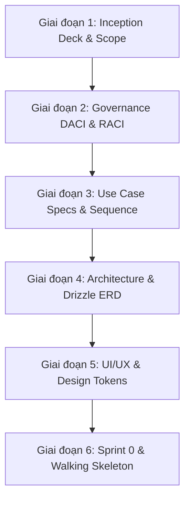

# Project Initiation and Execution Roadmap

## TL;DR

- **Bản chất**: Khung quy trình tích hợp từ Agile Inception Deck của Jonathan Rasmusson và Atlassian Team Playbook để khởi tạo dự án phần mềm.
- **Mục đích**: Triệt tiêu tình trạng hỗn loạn khi bắt đầu dự án, ngăn ngừa việc nhảy vào viết mã khi chưa rõ ranh giới nghiệp vụ và kiến trúc.
- **Điểm mấu chốt**: Tuân thủ nghiêm ngặt thứ tự từ phạm vi, phân công, đặc tả ca sử dụng, kiến trúc dữ liệu, rồi mới đến giao diện và mã nguồn.

---

## Thứ tự Triển khai Dự án Chuẩn Doanh nghiệp

Quy trình khởi tạo dự án được tổng hợp từ **Jonathan Rasmusson (Agile Inception Deck)**, **Atlassian Project Kickoff Play**, và khái niệm **Walking Skeleton của Alistair Cockburn**:

---

## Giai đoạn 1 - Định hình Sản phẩm và Ranh giới Nghiệp vụ (Agile Inception Deck)

Ứng dụng 10 câu hỏi cốt lõi của Jonathan Rasmusson (_The Agile Samurai_) để thiết lập bài toán:

- **Why are we here & Elevator pitch**: Phễu vấn đề từ khủng hoảng niềm tin vĩ mô đến tỷ lệ xuất hủy hàng tươi sống của nông trại.
- **The NOT list**: Khóa chặt những gì KHÔNG làm (loại bỏ Mobile App native, Multi-vendor, AI dự báo sản lượng).
- **What keeps us up at night (Pre-mortem Risk)**: Nhận diện rủi ro phụ thuộc API thanh toán và Google Maps; thiết lập Adapter Pattern dự phòng.
- **Mission tests (Atlassian Kickoff)**: Xác lập mục tiêu S.M.A.R.T định lượng (quét QR < 2s, 100% đơn hàng xuất đúng lô FEFO).

---

## Giai đoạn 2 - Phân công Trách nhiệm và Tổ chức Quản trị (DACI và RACI)

Ứng dụng khung Atlassian Team Playbook để làm rõ quyền hạn và ranh giới làm việc:

- **Khung ra quyết định DACI (Driver, Approver, Contributor, Informed)** kết hợp Ma trận RACI:

| Hạng mục công việc                           | Product Owner / Lead | Backend Engineer | Frontend Engineer | QA / Tester |
| -------------------------------------------- | -------------------- | ---------------- | ----------------- | ----------- |
| Định nghĩa User Story & Tiêu chí nghiệm thu  | Accountable          | Consulted        | Consulted         | Informed    |
| Thiết kế Sơ đồ Ca sử dụng & Sequence Diagram | Accountable          | Responsible      | Consulted         | Informed    |
| Thiết kế Drizzle Schema & PostgreSQL DB      | Consulted            | Responsible      | Informed          | Informed    |
| Thiết kế Figma UI & Design System            | Consulted            | Informed         | Responsible       | Consulted   |
| Xây dựng RESTful API & FEFO Logic            | Consulted            | Responsible      | Informed          | Informed    |
| Xây dựng Storefront & Dashboard UI           | Consulted            | Informed         | Responsible       | Informed    |
| Kiểm thử E2E & Kế hoạch Dự phòng             | Consulted            | Consulted        | Consulted         | Responsible |

- **Thiết lập công cụ làm việc**:
  - Khởi tạo GitHub Repository và cấu hình nhánh `main`, `develop`, `feature/*`.
  - Thiết lập bảng quản lý công việc (GitHub Projects / Jira) theo cột Backlog, Ready, In Progress, In Review, Done.
  - Quy chuẩn Commit Message theo chuẩn Conventional Commits (`feat:`, `fix:`, `docs:`, `refactor:`).

---

## Giai đoạn 3 - Phân tích Thiết kế Hệ thống và Ca sử dụng (Requirements và Modeling)

Chuyển hóa nghiệp vụ thành tài liệu kỹ thuật phần mềm:

- **Sơ đồ Ca sử dụng tổng quát (Use Case Diagram)**:
  - Phân rã chức năng cho 6 roles: `Guest`, `Customer`, `Farm Staff`, `Sales`, `Admin`, `SuperAdmin`.
- **Đặc tả Ca sử dụng chi tiết (Use Case Specifications)**:
  - Bắt buộc viết kịch bản chi tiết cho 3 luồng phức tạp nhất: (1) Khách đăng ký gói Subscription, (2) Sales xác nhận đơn hàng và hệ thống chạy FEFO trừ Lô, (3) Khách khiếu nại hàng dập nát kèm ảnh.
  - Mỗi đặc tả gồm: Mục đích, Tác nhân, Tiền điều kiện, Luồng cơ bản (Happy Path), Luồng thay thế (Alternative Paths), và Ngoại lệ (Exception Paths).
- **Sơ đồ Tuần tự (Sequence Diagram)**:
  - Luồng thanh toán trực tuyến và đối soát Webhook qua PayOS.
  - Luồng Scheduler tự động quét Subscription và sinh đơn hàng.

---

## Giai đoạn 4 - Thiết kế Kiến trúc Kỹ thuật và Mô hình Dữ liệu (Architecture và Data Design)

Khóa toàn bộ nền tảng dữ liệu và giao tiếp:

- **Bản ghi Quyết định Kiến trúc (ADRs)**: Lưu trữ các lý do chọn NestJS, Next.js, Drizzle ORM, PayOS, và Adapter Pattern.
- **Thiết kế Sơ đồ Quan hệ Thực thể (ERD)**:
  - Thực thể cốt lõi: `users`, `products`, `crops`, `farming_logs`, `batches`, `orders`, `order_items`, `batch_allocations`, `subscriptions`, `complaints`.
  - Đánh chỉ mục Index B-Tree phục vụ truy vấn FEFO: `batches(product_id, expiration_date)`.
- **Đặc tả Hợp đồng API (API Contracts)**:
  - Định nghĩa chuẩn mã lỗi, định dạng DTO yêu cầu và phản hồi cho từng endpoint qua Swagger/OpenAPI.

---

## Giai đoạn 5 - Thiết kế Trải nghiệm và Giao diện Người dùng (UI UX và Design System)

Hiện thực hóa màn hình trực quan cho cả 2 đối tượng người dùng:

- **Sơ đồ Cây Thông tin (Sitemap / Information Architecture)**: Phân tách rõ luồng Storefront công khai (`apps/storefront`) và Backoffice tác nghiệp nội bộ (`apps/backoffice`).
- **Wireframe độ trung thực thấp (Lo-fi Wireframe)**: Phác thảo bố cục lưới, vị trí các nút bấm và luồng giỏ hàng trên giấy hoặc Excalidraw.
- **Prototype độ trung thực cao (Hi-fi Mockup trên Figma)**:
  - Storefront: Giao diện tối giản, tôn vinh hình ảnh nông sản sạch, tối ưu hoàn toàn cho thiết bị di động (Mobile-first).
  - Backoffice (`apps/backoffice`): Giao diện dạng thẻ chạm (Card UI) tối ưu di động cho Farm Staff ngoài đồng ruộng; bảng dữ liệu dày đặc cho Sales điều phối FEFO, Admin duyệt hủy và SuperAdmin quản trị.
- **Design System Tokens**: Thiết lập bảng màu Tailwind CSS (xanh nông nghiệp, cam đất), font chữ dễ đọc, và các component chuẩn (Button, Modal, Input, Badge trạng thái đơn hàng).

---

## Giai đoạn 6 - Sprint 0 Khởi tạo Kỹ thuật và Walking Skeleton

Áp dụng nguyên lý **Walking Skeleton của Alistair Cockburn**: xây dựng một lát cắt mỏng nhất có thể thực thi từ đầu đến cuối (End-to-End) để phơi bày mọi rủi ro kỹ thuật hạ tầng trước khi bước vào Sprint 1:

- **Khởi tạo Cấu trúc Dự án (Monorepo)**:
  - Backend NestJS với các module khung: `auth`, `products`, `batches`, `orders`, `payment`.
  - Frontend Next.js (App Router) cho Storefront (`apps/storefront`) và React + Vite SPA kết hợp đồng bộ TanStack Router/Query/Table cho Backoffice (`apps/backoffice`).
- **Hạ tầng Cục bộ qua Docker Compose**:
  - Tệp `docker-compose.yml` khởi chạy container PostgreSQL 16 và Redis 7.
- **Drizzle Kit Migration Baseline**: Chạy lệnh sinh bảng ban đầu vào cơ sở dữ liệu.
- **Thực thi Walking Skeleton**: Tạo luồng mỏng xuyên suốt: Tạo sản phẩm từ UI $\rightarrow$ Gửi request sang NestJS API $\rightarrow$ Ghi nhận vào PostgreSQL $\rightarrow$ Trả dữ liệu hiển thị lại UI.

---

## Nguồn Tham chiếu Khung Chuẩn Doanh nghiệp

Tài liệu được xây dựng dựa trên các chuẩn công nghiệp được kiểm chứng:

- Jonathan Rasmusson, _The Agile Samurai: How Agile Masters Deliver Great Software_, Pragmatic Bookshelf (Agile Inception Deck: 10 structured kickoff activities).
- Scrum Manager BoK - Agile Inception Deck (<https://www.scrummanager.com/bok/index.php?title=Agile_inception_deck/en>)
- Atlassian Team Playbook, _Project Kickoff Play & DACI Framework_ (<https://www.atlassian.com/team-playbook/plays/project-kickoff>).
- Alistair Cockburn & Martin Fowler Architecture Guides, _Walking Skeleton Architecture Concept_ (<https://wiki.c2.com/?WalkingSkeleton>).
- E-commerce System Design: Catalog, Inventory, Checkout & Orders (https://seeitflow.com/system-design/intermediate/ecommerce/complete-design)

---

## Checklist Bàn giao Nghiệm thu Tuần 1

Nội dung tối thiểu cần hoàn thiện để nộp báo cáo Tuần 1 theo yêu cầu giảng viên:

- [ ] File báo cáo Word Chương 1 hoàn chỉnh (Lý do chọn đề tài, Phễu vấn đề, Mục tiêu S.M.A.R.T).
- [ ] Bảng Ma trận MoSCoW phân loại rõ ràng và lập luận bảo vệ cho từng tính năng.
- [ ] Bảng Phân tích cạnh tranh chi tiết đối chiếu với Shopee/Lazada và Bách Hóa Xanh.
- [ ] Đoạn văn Kế hoạch rủi ro kỹ thuật và phương án dự phòng Adapter Pattern.

---

## Related Notes

- Bản đồ dự án: [[000_GreenRoots_Farm_MOC]]
- Phân tích mô hình kinh tế: [[Business_Model_and_Domain_Analysis]]
- Quyết định kiến trúc hệ thống: [[System_Scope_and_Decision_Records]]
- Xử lý trường hợp biên: [[Operations_and_Edge_Cases_RFC]]
- Mẫu thiết kế tích hợp bên thứ ba: [[Third_Party_API_Adapter_Pattern_Strategy]]
- Cấu trúc hệ thống toàn cục: [[000_System_Structure]]
