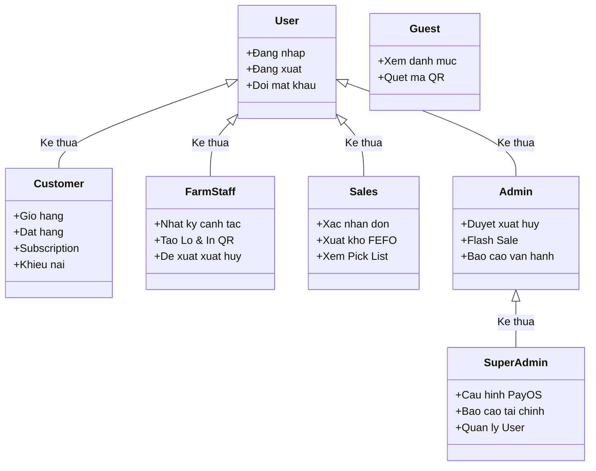

# Use Case Specification and Diagram Mapping

## TL;DR

- **Bản chất**: Tài liệu đặc tả cấu trúc phân rã ca sử dụng, quan hệ kế thừa tác nhân và ràng buộc quan hệ hình thức UML.
- **Mục đích**: Cung cấp thiết kế chuẩn mực để thành viên phụ trách tài liệu dựng sơ đồ Use Case trong báo cáo học thuật.
- **Điểm mấu chốt**: Thiết lập chính xác các liên kết bắt buộc include và mở rộng extend nhằm phản ánh trọn vẹn nghiệp vụ FEFO và truy xuất nguồn gốc.

---

## 1. Phân Cấp Tác Nhân và Quan Hệ Kế Thừa (Actor Generalization)

Hệ thống có 6 tác nhân chính (Primary Actors) và 2 tác nhân ngoại vi (Secondary Actors):

Các tác nhân ngoại vi hỗ trợ xử lý nền:

- **PayOS Gateway**: Tác nhân hệ thống xử lý giao dịch VietQR và gửi Webhook đối soát.
- **System Scheduler (Cron Job)**: Tác nhân thời gian tự động quét đơn Subscription lúc 04:00 sáng.

---

## 2. Bảng Ràng Buộc Quan Hệ Include và Extend

Để sơ đồ Use Case đạt điểm tối đa trong đồ án công nghệ phần mềm, các ca sử dụng không đứng độc lập mà liên kết chặt chẽ qua hai quan hệ chuẩn UML:

| Ca Sử Dụng Nguồn           | Loại Quan Hệ  | Ca Sử Dụng Đích                        | Điều Kiện / Ràng Buộc Nghiệp Vụ                                 |
| :------------------------- | :-----------: | :------------------------------------- | :-------------------------------------------------------------- |
| `Đặt hàng mua lẻ`          | `<<include>>` | `Tính khoảng cách & Phí ship`          | Bắt buộc phải tính km từ nông trại đến địa chỉ giao             |
| `Đặt hàng mua lẻ`          | `<<extend>>`  | `Áp dụng điểm thưởng`                  | Khách chọn cấn trừ điểm tích lũy 1% vào tổng tiền               |
| `Thanh toán đơn hàng`      | `<<extend>>`  | `Thanh toán VietQR qua PayOS`          | Khách chọn thanh toán chuyển khoản thay vì trả tiền mặt COD     |
| `Tra cứu Lô qua QR`        | `<<include>>` | `Xem nhật ký canh tác của Lô`          | Quét tem QR bắt buộc hiển thị toàn bộ lịch sử chăm sóc          |
| `Tạo Lô thu hoạch (Batch)` | `<<include>>` | `Khởi tạo mã QR định danh`             | Hệ thống tự sinh mã QR gắn liền với ID Lô                       |
| `Xác nhận đơn hàng`        | `<<include>>` | `Phân bổ trừ kho FEFO`                 | **Cốt lõi**: Tự động gán các Lô cận hạn vào `batch_allocations` |
| `Xác nhận đơn hàng`        | `<<include>>` | `Xuất danh sách nhặt hàng (Pick List)` | Nhân viên kho lấy danh sách để đóng gói đúng Lô chỉ định        |
| `Gửi khiếu nại bồi hoàn`   | `<<include>>` | `Tải ảnh minh chứng rau hỏng`          | Khách bắt buộc gửi 1-3 ảnh thực tế trong vòng 24 giờ            |
| `Lập phiếu xuất hủy`       | `<<include>>` | `Tải ảnh xác nhận rau hỏng`            | Kỹ sư nông trại bắt buộc chụp hiện trạng ngoài vườn/kho         |
| `Phê duyệt xuất hủy`       | `<<include>>` | `Trừ số lượng tồn kho Lô (Batch)`      | Admin bấm duyệt thì CSDL mới chính thức cập nhật tồn            |
| `Theo dõi tồn kho cận hạn` | `<<extend>>`  | `Kích hoạt Flash Sale giảm giá`        | Áp dụng khi Lô hàng có hạn sử dụng dưới 48 giờ                  |

---

## 3. Kiến Trúc 4 Phân Hệ Sơ Đồ Con (Sub-system Use Cases)

Do hệ thống có tới 30 ca sử dụng, nếu vẽ chung trên một mặt phẳng sẽ gây chồng chéo đường nối. Khuyến nghị phân rã thành 4 sơ đồ thành phần:

1. **Phân hệ 1 - Mua sắm & Khách hàng (Customer Storefront)**: `Guest`, `Customer` tương tác với Duyệt hàng, Giỏ hàng, Đặt hàng, Gói định kỳ, Khiếu nại và Tra cứu QR.
2. **Phân hệ 2 - Canh tác Nông trại (Farm Management)**: `Farm Staff` tương tác với Mùa vụ, Lô đất, Nhật ký canh tác (Append-only), Khởi tạo Lô và In tem QR.
3. **Phân hệ 3 - Kho & Điều phối Bán lẻ (Fulfillment)**: `Sales` tương tác với Quản lý đơn hàng, Xuất kho FEFO, Danh sách nhặt hàng và Sơ duyệt khiếu nại.
4. **Phân hệ 4 - Quản trị Cấp cao & Vận hành (Admin & Executive)**: `Admin`, `SuperAdmin` tương tác với Phê duyệt xuất hủy, Flash Sale, Báo cáo vận hành, Báo cáo dòng tiền, Cấu hình cổng thanh toán và Quản trị người dùng.

---

## Related Notes

- Bản đồ dự án: [[000_GreenRoots_Farm_MOC]]
- Đặc tả User Stories MoSCoW: [[MoSCoW_User_Stories_Specification]]
- Phân quyền 6 Roles RBAC: [[Role_Based_Access_Control_Specification]]
- Quyết định kiến trúc hệ thống: [[System_Scope_and_Decision_Records]]
- Sơ đồ ERD và Dữ liệu CSDL: [[Database_ERD_and_Data_Dictionary]]
- Cấu trúc hệ thống toàn cục: [[000_System_Structure]]
