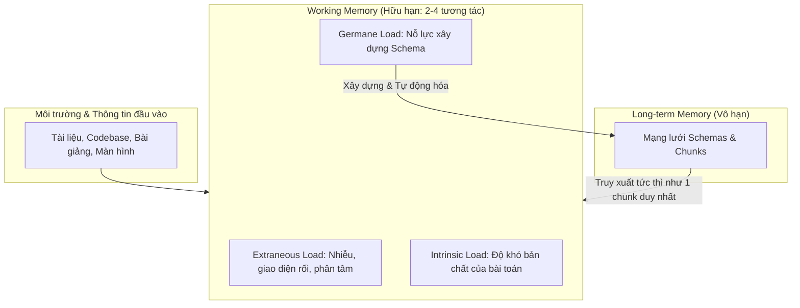

# Cognitive Load Theory

## TL;DR

- **Bản chất**: Lý thuyết của John Sweller (1988) mô hình hóa quan hệ giữa dung lượng hữu hạn của Working Memory và kho lưu trữ vô hạn của Long-term Memory.
- **Mục đích**: Triệt tiêu gánh nặng nhận thức thừa, kiểm soát độ phức tạp nội tại, và tối đa hóa nỗ lực xây dựng lược đồ nhận thức (Schema).
- **Điểm mấu chốt**: Tổng tải = Intrinsic Load + Extraneous Load + Germane Load; Cognitive Overload xảy ra khi tổng vượt ngưỡng Working Memory Capacity.

---

## Core Concept

Kiến trúc nhận thức của con người gồm hai thành phần:

1. **Working Memory (Bộ nhớ làm việc)**: bộ đệm xử lý thông tin tại thời điểm hiện tại, dung lượng cực kỳ hữu hạn (theo Miller chứa được $7 \pm 2$ mẩu tin; theo Sweller chỉ xử lý được 2 đến 4 yếu tố tương tác đồng thời, không duy trì quá 20–30 giây nếu thiếu lặp lại).
2. **Long-term Memory (Bộ nhớ dài hạn)**: kho lưu trữ tri thức gần như không giới hạn, nơi thông tin được tổ chức thành các **Schemas**. Khi một Schema đã tự động hóa, não đối xử cả khối Schema phức tạp đó như một đơn vị thông tin duy nhất trong Working Memory.

### 3 Thành phần của Cognitive Load

$$\text{Total Cognitive Load} = \text{Intrinsic Load} + \text{Extraneous Load} + \text{Germane Load} \le \text{Working Memory Capacity}$$

#### 1. Intrinsic Cognitive Load (Tải nhận thức nội tại)

- **Định nghĩa**: gánh nặng bắt buộc sinh ra từ bản chất và độ phức tạp vốn có của tài liệu.
- **Yếu tố quyết định**: **Element Interactivity** — nếu các khái niệm phụ thuộc chặt vào nhau (thuật toán đồng thuận Raft, Memory Management của Rust, bài toán Concurrency), người học không thể hiểu từng biến số độc lập mà buộc phải nạp toàn bộ vào Working Memory cùng lúc.
- **Chiến lược can thiệp**: không giảm được độ khó bản chất, nhưng chia nhỏ tuần tự bằng Scaffolding và Chunking.

#### 2. Extraneous Cognitive Load (Tải nhận thức ngoại lai)

- **Định nghĩa**: gánh nặng lãng phí do cách trình bày tài liệu vụng về, giao diện rối, tài liệu lan man hoặc môi trường nhiều yếu tố phân tâm.
- **Ví dụ**: tài liệu có code một nơi, chú thích tít phía dưới; màn hình vừa học vừa mở cửa sổ chat; điện thoại đặt trên bàn khiến não phải tiêu tài nguyên để ức chế việc cầm lên.
- **Chiến lược can thiệp**: phải triệt tiêu về tiệm cận mức 0 để nhường toàn bộ dung lượng cho hai thành phần còn lại.

#### 3. Germane Cognitive Load (Tải nhận thức tạo dựng)

- **Định nghĩa**: nỗ lực nhận thức tích cực dành cho việc tích hợp thông tin mới, liên kết với tri thức cũ và tái cấu trúc thành Schemas bền vững.
- **Cơ chế**: đây là "tải có ích" — Self-Explanation, phân loại Design Patterns và Active Recall chính là chủ động tăng Germane Load để đẩy nhanh quá trình làm chủ tri thức.

## Related Notes

- Bốn hiệu ứng kinh điển và bảng chiến lược theo từng loại tải: [[Cognitive_Load_Applied_Strategies]]
- [[Herbert_Simon_Learning_Method]]: Nền tảng về Working Memory hữu hạn và cơ chế Chunking.
- [[Dunlosky_Learning_Techniques_Matrix]]: Khung đánh giá kỹ thuật học tập theo hiệu quả quản lý tải nhận thức.
- [[Wozniak_20_Rules_of_Formulating_Knowledge]]: Ứng dụng CLT vào thiết kế flashcard nguyên tử.
- [[Cognitive_Stack_Framework]]: Phân tầng nhận thức để định hướng phân bổ năng lượng tư duy.
