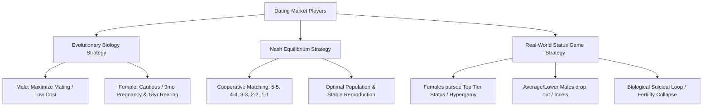

# Dating Game Theory

## TL;DR

- **Bản chất**: Mô hình hóa thị trường hẹn hò bằng ba thành tố players, rules/constraints và incentives, và cho rằng nó đang vận hành như một status game tổng bằng không.
- **Mục đích**: Dùng lý thuyết trò chơi thay vì quy kết tâm lý cá nhân để giải thích hành vi tập thể trên thị trường hôn nhân.
- **Điểm mấu chốt**: Đây là mô hình diễn giải, không phải dự báo định lượng; kết luận về sụp đổ văn minh là suy diễn vượt quá dữ liệu mà mô hình 3 thành tố có thể chống đỡ.

---

## Core Framework of Game Theory

Lý thuyết trò chơi cung cấp khung tư duy để phân tích hành vi của con người, tổ chức và quốc gia qua 3 thành tố cốt lõi:

1. **Players (Người chơi):** các cá nhân hoặc thực thể tham gia trò chơi (trong thị trường hẹn hò là nam giới và nữ giới).
2. **Rules / Constraints (Luật chơi & Ràng buộc):** giới hạn sinh học, chuẩn mực xã hội, pháp luật, thể chế và trình độ kinh tế - công nghệ.
3. **Incentives (Động cơ & Phần thưởng):** mục tiêu người chơi hướng tới để tối đa hóa lợi ích cá nhân (địa vị, tài sản, gen, sự an toàn).

### 3 Lợi ích khi làm chủ Game Theory

- **Tư duy phản biện:** hiểu lý do đằng sau quyết định và hành vi xã hội thay vì đánh giá bề nổi.
- **Giải mã thực tại:** phân tích nguyên nhân cốt lõi của biến động chính trị, kinh tế, địa chính trị và xung đột xã hội.
- **Năng lực dự đoán:** nhìn thấy hướng phát triển của xã hội và cuộc sống cá nhân, từ đó làm chủ vận mệnh (Sovereignty).

## Dating Game Model & Nash Equilibrium

### 3 Tiêu chí đánh giá giá trị thu hút

- **Gen (Genes):** ngoại hình, chiều cao, sức khỏe, khả năng sống thọ và truyền lại bộ gen tốt.
- **Tài sản (Wealth):** khả năng tài chính cá nhân và tiềm lực gia đình.
- **Địa vị xã hội (Status):** quyền lực, công việc có vị thế cao, mạng lưới quan hệ xã hội.

1. **Động lực Sinh học Tiến hóa (Evolutionary Psychology):**
   - **Nam giới:** chi phí sinh học thấp $\rightarrow$ động cơ tối đa hóa số lượng bạn đời để truyền gen.
   - **Nữ giới:** chi phí sinh học cực cao (mang thai 9 tháng, nuôi dạy 16-18 năm) $\rightarrow$ động cơ cực kỳ thận trọng trong lựa chọn bạn đời.
2. **Cân bằng Nash Lý tưởng (Nash Equilibrium):**
   - Chiến lược hợp tác tốt nhất là ghép đôi tương đồng theo thứ hạng: hạng 5 ghép hạng 5, 4 ghép 4, 3 ghép 3, 2 ghép 2, 1 ghép 1.
   - Trạng thái này giúp mọi người chơi đạt kết quả tốt nhất có thể và duy trì tỷ lệ sinh thay thế (Replacement Rate $\ge 2.1$).

### Thực tế lệch khỏi Nash: Trò chơi Địa vị

Trong thực tế, xã hội không vận hành theo Cân bằng Nash lý tưởng vì:

- **Động cơ thực sự không phải tình dục hay sinh sản mà là ĐỊA VỊ:** người ta chọn bạn đời để phô trương xã hội (Instagram, khoe khoang, làm người khác ghen tị) hơn là duy trì nòi giống.
- **Sự trỗi dậy của Hypergamy:** phụ nữ tập trung cạnh tranh vào nhóm nhỏ nam giới ở đỉnh cao địa vị/tài sản.
- **Hiện tượng Rút lui (Incels):** nhóm nam giới trung bình và thấp (hạng 1, 2, 3) từ bỏ cuộc chơi hẹn hò, rút lui vào trò chơi điện tử, phim ảnh và nội dung khiêu dâm.
- **Chiến lược "Tự sát Sinh học":** sự tập trung vào địa vị khiến đại đa số người chơi không sinh con, dẫn đến sụt giảm dân số tự nhiên.

## Related Notes

- Kiến trúc thượng tầng và hệ quả dân số qua ba giai đoạn: [[Dating_Market_Superstructures_and_Fertility]]
- Tổng quan MOC khái niệm: [[000_Concepts_MOC]]
- Tư duy Hệ thống: [[Systems_Thinking]]
- Các mô hình tư duy phản biện: [[Critical_Thinking_Models]]
