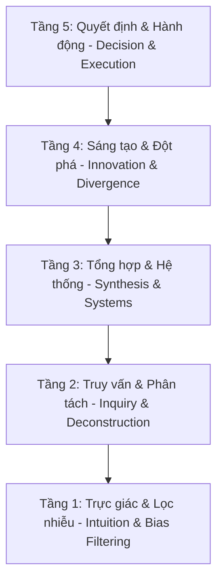

# Cognitive Stack Framework

## TL;DR

- **Bản chất**: Khung gom mental model theo chức năng: lọc, phân tách, nhìn cấu trúc, kiến tạo giá trị, thực thi; tầng dưới làm sạch dữ liệu cho tầng trên.
- **Mục đích**: Tránh nhảy thẳng sang tầng quyết định khi dữ liệu đầu vào còn nhiễu, và biết mình đang thiếu tầng nào.
- **Điểm mấu chốt**: Các tầng có thứ tự phụ thuộc: một quyết định tốt ở tầng trên vô nghĩa nếu tầng lọc bên dưới đã nhận dữ liệu sai.

---

## Core Concept

Khung phân cấp nhận thức giải quyết bài toán "quá tải thông tin" và "tê liệt phân tích" (Analysis Paralysis) bằng cách sắp xếp các công cụ tư duy theo đúng chu trình xử lý tự nhiên của não bộ.

Một mental model đơn lẻ như Confirmation Bias chỉ là bộ lọc làm sạch dữ liệu đầu vào. Giải bài toán phức tạp đòi hỏi phối hợp nhiều mô hình ở các tầng trừu tượng khác nhau.

---

## The 5-Layer Cognitive Stack

### Tầng 1: Trực giác & Lọc nhiễu

- **Bản chất:** tầng tiền xử lý dữ liệu, nhận diện phản xạ nhanh của Hệ thống 1 để lọc lỗi nhận thức trước khi phân tích chuyên sâu.
- **Các mô hình cốt lõi:**
  - _Confirmation Bias:_ tránh chỉ tìm bằng chứng ủng hộ ý kiến sẵn có.
  - _False Dichotomy:_ phá bẫy trắng-đen, nhìn vấn đề như dải phổ và đánh đổi.
  - _Negativity Bias & Outrage Economy:_ nhận diện và ngắt phản xạ giận dữ bị thuật toán mạng xã hội thao túng.
  - _Availability Heuristic & Base Rate:_ hiệu chuẩn xác suất thực tế, tránh đánh giá hiện trạng qua sự kiện giật gân cá biệt.
  - _Survivorship Bias:_ tránh chỉ học từ các trường hợp thành công nổi bật.
  - _Sunk Cost Fallacy:_ tránh tiếp tục đầu tư vào con đường sai chỉ vì tiếc công sức đã bỏ ra.
- **Điểm chốt:** điểm bắt đầu của mọi suy nghĩ phải là dữ liệu khách quan (Garbage In, Garbage Out).

### Tầng 2: Truy vấn & Phân tách Nguyên bản

- **Bản chất:** bóc tách vấn đề phức tạp thành các sự thật cơ bản không thể chối cãi, phá vỡ định kiến kế thừa và tư duy bắt chước (Analogy).
  - _First Principles Thinking:_ phân rã vấn đề đến cấp vật lý/toán học hoặc giá trị nguyên bản để tái cấu trúc.
  - _Socratic Questioning:_ liên tục truy vấn các giả định ngầm để làm sáng tỏ bản chất luận điểm.
  - _Spectrum Thinking:_ chuyển từ trạng thái nhị phân sang dải liên tục đa biến số để tìm điểm cân bằng.
- **Điểm chốt:** hiểu tận gốc kiến thức (Cook vs. Chef) thay vì học vẹt.

### Tầng 3: Tư duy Hệ thống & Quan hệ Liên kết

- **Bản chất:** lắp các mảnh sự thật đã bóc tách ở Tầng 2 vào bức tranh tổng thể để quan sát liên hệ phức tạp, vòng lặp phản hồi và hệ quả lâu dài.
- **Các mô hình cốt lõi:**
  - _Systems Thinking:_ nhìn phần mềm, tổ chức hoặc xã hội dưới dạng các phần tử và ràng buộc tương tác.
  - _Second-Order Thinking:_ hỏi "Và sau đó là gì?" để dự đoán tác động dây chuyền.
  - _Institutional Tradeoffs Framework:_ phân tích hệ thống kinh tế - xã hội theo chi phí đánh đổi và ràng buộc lịch sử.
- **Điểm chốt:** tránh tối ưu hóa cục bộ nhưng làm hỏng toàn cục (Local vs. Global Optimization).

### Tầng 4: Sáng tạo & Đa chiều

- **Bản chất:** tìm lối đi mới, giải pháp đột phá phi truyền thống sau khi đã xác định rõ quy luật vật lý (Tầng 2) và ràng buộc hệ thống (Tầng 3).
- **Các mô hình cốt lõi:**
  - _Lateral Thinking:_ đổi góc tiếp cận theo hướng không ngờ tới thay vì tư duy logic dọc.
  - _Design Thinking:_ bám vào hành vi thực tế và trải nghiệm người dùng cuối để thiết kế giải pháp.
- **Điểm chốt:** tạo ra sáng kiến, công nghệ hoặc hướng sự nghiệp mà người khác không nhìn thấy.

### Tầng 5: Quyết định Chiến lược & Thực thi

- **Bản chất:** tầng ra quyết định và tối ưu hành động dưới áp lực bất định cùng giới hạn tài nguyên (thời gian, tiền bạc, năng lượng).
- **Các mô hình cốt lõi:**
  - _Locus of Control & Circle of Influence:_ dồn năng lượng vào việc kiểm soát được, triệt tiêu tâm lý bất lực đổ lỗi.
  - _Probabilistic Thinking:_ đánh giá rủi ro và phần thưởng theo phân phối xác suất thay vì đúng/sai nhị phân.
  - _Opportunity Cost:_ đánh giá đánh đổi giữa các lựa chọn để tối ưu phân bổ nguồn lực.
  - _Deliberate Practice:_ tập trung vào vùng khó của bản thân để nâng cao kỹ năng thực chiến.
- **Điểm chốt:** đưa ra quyết định đầu tư, sự nghiệp và thực thi dự án khi thông tin thiếu nhất quán.

## Related Notes

- Điều kiện tiên quyết và lợi ích của khung này: [[Cognitive_Stack_Preconditions_and_Benefits]]
- [[Confirmation_Bias]], [[False_Dichotomy]]: bộ lọc thiên kiến ở Tầng 1.
- [[Spectrum_Thinking]]: mô hình dải phổ phi nhị phân.
- [[Institutional_Tradeoffs_Framework]]: phân tích đánh đổi hệ thống ở Tầng 3.
- [[Locus_of_Control_and_Circle_of_Influence]]: vùng kiểm soát ở Tầng 5.
- [[First_Principles_Thinking]], [[Systems_Thinking]]: hai mô hình nền của Tầng 2 và Tầng 3.
- [[Critical_Thinking_Models]]: tổng quan các mô hình tư duy phản biện.
- [[000_Concepts_MOC]]: bản đồ khái niệm tâm lý học.
