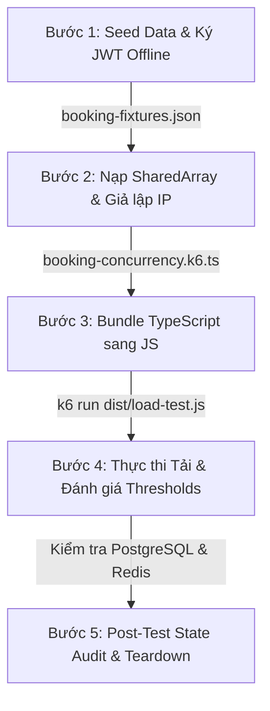

# High-Concurrency Load Testing SOP with Grafana k6

## TL;DR

- **Bản chất**: SOP 5 bước test tranh chấp cao 500-2.000 VUs để kiểm định distributed lock, pessimistic locking và rate limiter.
- **Mục đích**: Tránh ba cạm bẫy làm sai kết quả: false bottleneck do login, IP collision do throttler, và RAM explosion do nhân bản fixture mỗi VU.
- **Điểm mấu chốt**: Chuẩn bị trước khi đo: ký JWT offline, nạp qua `SharedArray`, giả lập IP bằng `X-Forwarded-For`, rồi đối soát database state sau test.

---

## Context: When to apply?

Áp dụng quy chuẩn này khi:

1. Phát triển tính năng có tranh chấp cao: đặt vé máy bay/rạp phim (Seat Reservation), Flash-Sale, ví điện tử / chuyển tiền.
2. Cần kiểm định tính toàn vẹn của khóa phân tán ([[Redis_Redlock]]) và khóa bi quan ([[Postgres_Select_For_Update_Pessimistic_Locking]]) nhằm đảm bảo **Zero Double-Booking**.
3. Cần thiết lập cổng kiểm soát chất lượng (Quality Gate) tự động trong CI/CD.

---

## Step-by-Step Execution Protocol



### Bước 1: Seed Dữ liệu & Ký JWT Token Offline

- **Cơ chế**: tuyệt đối không cho VUs gọi HTTP `POST /auth/login` trong k6 vì thuật toán hash mật khẩu (Scrypt/Argon2/Bcrypt) sẽ làm nghẽn CPU trước khi request chạm tới module nghiệp vụ.
- **Hành động**:
  1. Viết script seed (`seed.ts`) tạo trước $N$ user trong Database.
  2. Ký trước $N$ token JWT hợp lệ bằng `JWT_SECRET` của dự án.
  3. Xuất toàn bộ dữ liệu ra file JSON gọn nhẹ (`booking-fixtures.json`).

### Bước 2: Nạp Dữ liệu qua SharedArray & Giả lập Header IP

- **Cơ chế**: chạy k6 trên 1 máy runner khiến mọi request xuất phát từ `127.0.0.1`; Rate Limiter sẽ chặn từ request thứ 11 (HTTP 429), ngăn request chạm vào logic khóa ghế.
- **Hành động**:
  1. Dùng `SharedArray` nạp `booking-fixtures.json` **1 lần duy nhất** vào Go memory.
  2. Phân phối token cho từng VU qua `vu.idInTest` (`import { vu } from "k6/execution"`).
  3. Mỗi VU gán IP giả lập riêng qua `X-Forwarded-For: 10.0.${Math.floor(id/256)}.${id%256}` kết hợp cấu hình `trust proxy` trên server.
  4. Tạo `idempotency-key` duy nhất cho từng request bằng UUIDv7.

### Bước 3: Đóng gói TypeScript sang chuẩn Goja Runtime

- **Cơ chế**: k6 chạy trên Goja JavaScript engine, không hỗ trợ TypeScript và các module native của Node.js (`fs`, `crypto`, `path`).
- **Hành động**: đóng gói kịch bản thành file JavaScript độc lập trước khi chạy:

```bash
bun build test/load/booking-concurrency.k6.ts --target=browser --outfile dist/load-test.js
```

### Bước 4: Thực thi Tải với Ngưỡng Bất biến (Invariant Thresholds)

- **Hành động**:
  - Chạy k6 với executor `per-vu-iterations` (`iterations: 1`) để tạo xung đột tức thời tại $t=0$.
  - Cấu hình Thresholds nghiêm ngặt để xác thực tính đúng đắn toán học:

```typescript
thresholds: {
  reserve_success_201: ["count==1"],                  // Duy nhất 1 ghế được giữ
  reserve_conflict_409: [`count==${totalVus - 1}`],   // Còn lại nhận 409
  reserve_unexpected_errors: [
    { threshold: "count==0", abortOnFail: true, delayAbortEval: "1s" }
  ],
},
```

### Bước 5: Đối soát Cơ sở dữ liệu và Thu dọn (Audit & Teardown)

- **Cơ chế**: báo cáo HTTP 201 của k6 chỉ phản ánh tầng giao tiếp mạng, chưa chứng minh trạng thái dữ liệu trong database không bị ghi đè ngầm.
- **Hành động**:
  1. Chạy script đối soát sau test:
     - Truy vấn `SELECT count(*) FROM bookings WHERE show_id = :showId` → kết quả **bắt buộc $= 1$**.
     - Truy vấn `show_seats` → đúng 1 bản ghi mang trạng thái `reserved`.
     - Kiểm tra Redis key lock → khóa đã giải phóng hoàn toàn, không deadlock.
  2. Xóa sạch dữ liệu test để đảm bảo tính tái lập cho lần chạy sau.

## Related Notes

- Blueprint kịch bản k6 đầy đủ: [[K6_Concurrency_Script_Blueprint]]
- Kiến trúc bộ nhớ và vòng đời k6: [[K6_Execution_Lifecycle_and_Memory_Architecture]]
- Mô hình kịch bản thực thi k6: [[K6_Scenario_Executors_and_Workload_Modeling]]
- Hệ thống đo lường và ngưỡng kiểm định k6: [[K6_Telemetry_Metrics_and_Threshold_Gates]]
- Cơ chế khóa phân tán Redis Redlock: [[Redis_Redlock]]
- Cơ chế khóa bi quan Postgres: [[Postgres_Select_For_Update_Pessimistic_Locking]]
- Bản đồ quy trình kỹ thuật: [[000_Methods_MOC]]
