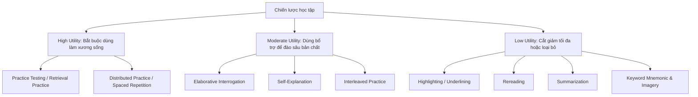

# Dunlosky Learning Techniques Matrix

## TL;DR

- **Bản chất**: Hệ thống đánh giá hiệu quả thực chứng của 10 kỹ thuật học tập phổ biến, do John Dunlosky và cộng sự công bố năm 2013 trên tạp chí của APS.
- **Mục đích**: Triệt tiêu các thói quen học tập trực giác nhưng kém hiệu quả, phân bổ thời gian vào các kỹ thuật có năng suất cao nhất đã được kiểm chứng.
- **Điểm mấu chốt**: Practice Testing và Distributed Practice đứng đầu ở mức High Utility; Rereading và Highlighting xếp chót ở Low Utility vì tạo ảo tưởng thông thạo (Illusion of Competence).

---

## Core Concept

- **Nguồn:** chuyên khảo của Dunlosky et al. (2013), _Psychological Science in the Public Interest_.
- **Phương pháp:** tổng hợp hàng trăm nghiên cứu thực nghiệm độc lập, đo mức hữu dụng (Utility) của 10 phương pháp theo 4 biến số:
  1. **Tính tổng quát của tài liệu**: có áp dụng được cho từ vựng, toán học, khoa học máy tính lẫn nội dung trừu tượng không?
  2. **Đối tượng người học**: có hiệu quả với mọi lứa tuổi và mức năng lực nhận thức không?
  3. **Ngữ cảnh học tập**: có hoạt động tốt khi tự học lẫn học tại lớp không?
  4. **Độ bền lưu giữ**: kiến thức có tồn tại sau khoảng hoãn dài hạn (ngày, tuần, tháng) không?

## Bảng xếp hạng 10 Kỹ thuật học tập theo Dunlosky (2013)

| Xếp hạng Utility     | Kỹ thuật                       | Cơ chế hoạt động                                                                                                 | Đánh giá khoa học                                                                                                                          |
| :------------------- | :----------------------------- | :--------------------------------------------------------------------------------------------------------------- | :----------------------------------------------------------------------------------------------------------------------------------------- |
| **High Utility**     | **Practice Testing**           | Tự kiểm tra, trả lời câu hỏi, làm bài tập thực hành mà không nhìn đáp án (Retrieval Practice).                   | Kích hoạt Testing Effect: ép não truy xuất thông tin để củng cố trực tiếp đường mòn liên kết thần kinh, hiệu quả bền vững với mọi môn học. |
| **High Utility**     | **Distributed Practice**       | Phân bổ phiên học ngắt quãng theo thời gian thay vì nhồi nhét trong một buổi (Spaced Repetition).                | Chống lại đường cong quên lãng của Ebbinghaus; buộc não tái kích hoạt quá trình củng cố khớp thần kinh (Synaptic Consolidation).           |
| **Moderate Utility** | **Elaborative Interrogation**  | Chủ động truy vấn nguyên nhân: "Tại sao sự thật này đúng?", "Tại sao cơ chế này hoạt động như vậy?".             | Kết nối sự thật mới vào mạng lưới tri thức nền trong Long-term Memory; rất mạnh khi học quy luật hệ thống.                                 |
| **Moderate Utility** | **Self-Explanation**           | Tự giải thích từng bước giải bài toán hoặc liên hệ kiến thức mới với điều đã biết.                               | Làm sáng tỏ lỗ hổng nhận thức (Mental Blindspots); hỗ trợ theo dõi và hiệu chuẩn dòng tư duy (Metacognitive Monitoring).                   |
| **Moderate Utility** | **Interleaved Practice**       | Học xen kẽ nhiều dạng bài toán hoặc chủ đề trong một buổi thay vì luyện nguyên khối một dạng (Blocked Practice). | Rèn kỹ năng phân loại và nhận diện dạng bài toán (Pattern Discrimination); hiệu quả với Toán, Thuật toán và chẩn đoán lỗi.                 |
| **Low Utility**      | **Summarization**              | Đọc tài liệu rồi viết lại bản tóm tắt ý chính.                                                                   | Hiệu quả phụ thuộc quá lớn vào kỹ năng viết tóm tắt; đa số người học chỉ sao chép văn bản một cách thụ động.                               |
| **Low Utility**      | **Highlighting / Underlining** | Dùng bút nhớ đánh dấu từ khóa hoặc câu quan trọng.                                                               | Hầu như không đem lại lợi ích ghi nhớ; tách từ khóa khỏi ngữ cảnh và tạo cảm giác ảo rằng não đã tiếp thu.                                 |
| **Low Utility**      | **Keyword Mnemonic**           | Ghép từ mới với từ có phát âm tương tự trong tiếng mẹ đẻ kèm hình ảnh liên tưởng.                                | Tốn thời gian thiết kế nhưng khó áp dụng cho khái niệm trừu tượng; độ bền ghi nhớ suy giảm nhanh.                                          |
| **Low Utility**      | **Imagery for Text**           | Hình dung một bức tranh thị giác tương ứng với nội dung đoạn văn đang đọc.                                       | Chỉ có tác dụng với văn bản giàu hình tượng cụ thể; khó áp dụng cho môn kỹ thuật, logic hoặc lập trình.                                    |
| **Low Utility**      | **Rereading**                  | Đọc đi đọc lại một tài liệu nhiều lần sau lần đọc đầu.                                                           | Kém hiệu quả nghiêm trọng so với Practice Testing; chỉ làm tăng độ quen thuộc thị giác (Familiarity), gây Illusion of Competence.          |

## Related Notes

- Quy trình thay thế thói quen học tập, và vì sao thói quen kém vẫn phổ biến: [[Study_Habit_Upgrade_Protocol]]
- [[Ultralearning_Framework]]: Vận dụng trực tiếp nguyên tắc Retrieval và Retention từ chuyên khảo Dunlosky.
- [[Spaced_Repetition_SM2]]: Thuật toán dãn cách cụ thể hóa kỹ thuật Distributed Practice.
- [[Cognitive_Load_Theory]]: Giải thích vì sao Practice Testing và Interleaving giúp giải phóng Working Memory.
- [[Herbert_Simon_Learning_Method]]: Nền tảng Chunking hỗ trợ tổ chức kiến thức trước khi test.
- [[Wozniak_20_Rules_of_Formulating_Knowledge]]: Tiêu chuẩn thiết kế câu hỏi cho Practice Testing không bị quá tải.
