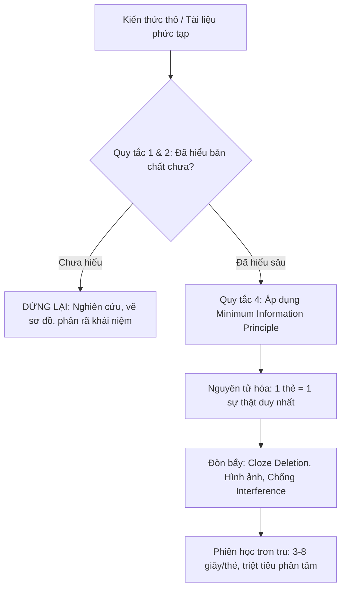

# Flashcard: Vì sao bộ thẻ gây quá tải Nhận thức

## TL;DR

- **Bản chất**: Học flashcard bế tắc không do trí nhớ hay thuật toán mà do cách diễn đạt kiến thức: thẻ quá tải làm nghẽn Working Memory và sinh Cognitive Friction.
- **Mục đích**: Nhận diện triệu chứng (thẻ tồn đọng dồn cục, mỗi phiên học thấy mệt và bị phân tâm) để sửa ở gốc là viết lại thẻ.
- **Điểm mấu chốt**: Não đổi sang tìm dopamine thay thế khi thẻ quá khó; bản viết lại chuẩn phải trả lời được trong 3–8 giây.

## Core Concept: Ba Trụ cột nền tảng

1. **Hiểu trước khi ghi nhớ (_Do not learn if you do not understand_)**: nhồi ký hiệu, thuật ngữ hay công thức chưa nắm cơ chế chỉ tạo "rác nhận thức"; não đào thải nhanh và sinh phản xạ ức chế học tập.
2. **Nguyên tử hóa thông tin (_Minimum Information Principle_)**: thẻ càng đơn giản thì phản xạ càng nhanh. Thẻ phức tạp buộc phải đọc và suy luận, làm tắc Working Memory và tạo **Cognitive Friction** thúc đẩy hành vi tìm dopamine thay thế.
3. **Bảo trì liên tục (_Card Maintenance & Leech Eradication_)**: soạn thẻ là quá trình hiệu chỉnh liên tục. Một thẻ bị quên lặp lại nhiều lần (Leech) là tín hiệu thẻ viết sai cấu trúc — phải viết lại, xẻ nhỏ hoặc xóa, không nhồi tiếp.

## Vòng đời một thẻ: từ kiến thức thô đến phiên học trơn tru

- Triệu chứng khi bỏ qua vòng này: số thẻ tồn đọng dồn cục, mỗi phiên học mệt mỏi, vừa mở phần mềm đã muốn mở YouTube hoặc kiểm tra điện thoại.
- Chẩn đoán đúng là "thẻ viết sai", không phải "trí nhớ kém"; thuốc là bộ quy tắc tại [[Wozniak_20_Rules_of_Formulating_Knowledge]].

## Thẻ tồi và thẻ tốt: ví dụ Redis

**Vi phạm Minimum Information Principle (thẻ tồi, thúc đẩy mở YouTube):**

- _Câu hỏi_: `Trình bày kiến trúc Redis, cơ chế đơn luồng, các kiểu dữ liệu và cách Redis giải quyết bài toán Concurrency?`
- _Đáp án_: một đoạn văn 15 dòng giải thích Event Loop, epoll, String, Hash, List, Set, ZSet và cơ chế single-threaded execution.
- _Hậu quả_: mỗi lần lật thẻ mất 30 giây để đọc, không biết mình nhớ đúng bao nhiêu phần, nản lòng và đi tìm dopamine từ việc lướt web.

**Viết lại chuẩn Atomic 3–8 giây:**

- _Thẻ 1_: `[Redis] Lý do cốt lõi giúp Redis đạt hiệu năng hàng trăm nghìn RPS chỉ với single-threaded event loop?` → `Toàn bộ dữ liệu nằm trên In-Memory RAM + non-blocking I/O multiplexing (epoll/kqueue) triệt tiêu context switching.`
- _Thẻ 2_: `[Redis] Thao tác đọc/ghi một Key đơn lẻ có xảy ra Race Condition giữa các lệnh đồng thời không? Vì sao?` → `Không. Vì Single-Threaded Event Loop xử lý tuần tự từng lệnh trong Main Thread.`

## Related Notes

- Bộ 20 quy tắc chuẩn hóa tri thức: [[Wozniak_20_Rules_of_Formulating_Knowledge]]
- [[Cognitive_Load_Theory]]: Cơ chế Extraneous Load đứng sau hiện tượng quá tải này.
- [[Spaced_Repetition_SM2]]: Thuật toán lặp lại ngắt quãng chỉ phát huy tác dụng khi thẻ đã nguyên tử.
- [[Ultralearning_Framework]]: Nguyên tắc Drill và Retrieval để tinh chỉnh bộ thẻ cá nhân.
