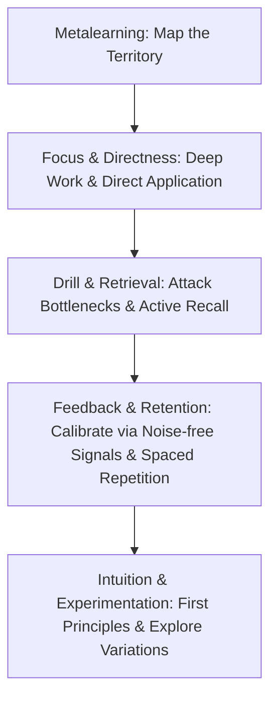

# Ultralearning Framework

## TL;DR

- **Bản chất**: Chiến lược tự định hướng học tập (_Self-Directed Learning_) với cường độ tập trung cao độ (_High Intensity_), tối ưu hóa tốc độ và chiều sâu tiếp thu kỹ năng.
- **Mục đích**: Phá vỡ bẫy học tập thụ động (_Passive Learning_), rút ngắn thời gian làm chủ kiến thức phức tạp mà không phụ thuộc vào trường lớp chính quy.
- **Điểm mấu chốt**: Vận hành dựa trên 9 nguyên tắc cốt lõi, tập trung vào học trực tiếp (_Directness_), vòng lặp phản hồi tức thì (_Immediate Feedback_), và thực hành truy xuất (_Retrieval Practice_).

---

## Core Concept

- **Nguồn gốc:** khái niệm được hệ thống hóa bởi Scott H. Young, tác giả thử nghiệm _MIT Challenge_ (hoàn thành chương trình Computer Science 4 năm trong 12 tháng).
- **Không phải mẹo ghi nhớ:** Ultralearning là một **Mental Framework** có cấu trúc để tự thiết kế và thực thi các dự án học tập chuyên sâu.

### 9 Core Principles

1. **Metalearning**:
   - Dành 5-10% tổng thời gian dự án để vẽ bản đồ cấu trúc: phân tích _Concepts_, _Facts_, và _Procedures_.
   - Benchmark lộ trình từ những người đã thành thạo để xác định tài liệu và phương pháp tối ưu.
2. **Focus**:
   - Thiết lập các khối thời gian [[Deep_Work]] không bị gián đoạn.
   - Vượt qua sức ỳ ban đầu và duy trì trạng thái _Flow State_.
3. **Directness**:
   - Học kỹ năng ngay trong ngữ cảnh thực tế mà kỹ năng đó được sử dụng (ví dụ: học lập trình bằng cách xây dựng ứng dụng thực tế, học ngoại ngữ qua giao tiếp trực tiếp).
   - Loại bỏ rào cản _Transfer Problem_ vốn thường gặp khi chỉ làm bài tập giả lập.
4. **Drill**:
   - Phân rã kỹ năng phức tạp thành các thành phần nhỏ, sau đó cô lập mắt xích yếu nhất (_Bottleneck_) để áp dụng _Deliberate Practice_.
   - Lặp lại cho đến khi thao tác trở thành phản xạ.
5. **Retrieval**:
   - Tự kiểm tra bằng _Active Recall_ thay vì đọc lại tài liệu một cách thụ động (_Passive Review_).
   - Tận dụng _Testing Effect_ để củng cố đường mòn liên kết thần kinh.
6. **Feedback**:
   - Tìm kiếm các tín hiệu phản hồi trực diện, nhanh và chính xác nhất có thể.
   - Phân loại rõ ràng _Outcome Feedback_, _Informational Feedback_, và _Correctional Feedback_ để hiệu chỉnh hành động.
7. **Retention**:
   - Chống lại _Ebbinghaus Forgetting Curve_ bằng [[Spaced_Repetition_SM2]].
   - Chuyển hóa kiến thức từ _Working Memory_ sang _Long-term Memory_ thông qua thực hành định kỳ.
8. **Intuition**:
   - Thấu hiểu cơ chế gốc rễ thay vì học thuộc lòng công thức hoặc cú pháp.
   - Áp dụng kỹ thuật giải thích đơn giản hóa (_Feynman Technique_) để kiểm tra độ hổng kiến thức, liên hệ trực tiếp với [[First_Principles_Thinking]].
9. **Experimentation**:
   - Khi đã đạt ngưỡng thành thạo cơ bản, liên tục thử nghiệm các phương pháp mới, công cụ mới, và phong cách tiếp cận khác biệt để vượt qua điểm bình nguyên (_Plateau_).

---

## Chu trình dự án 3 giai đoạn

Một chu kỳ Ultralearning chuẩn mực bao gồm 3 giai đoạn:

| Giai đoạn              | Hành động cụ thể                                                                                                  | Output đo lường                                                         |
| :--------------------- | :---------------------------------------------------------------------------------------------------------------- | :---------------------------------------------------------------------- |
| **1. Scoping**         | Xác định phạm vi dự án, thời lượng (ví dụ: 100 giờ trong 1 tháng), thu thập tài liệu và phân tích Metalearning.   | Lộ trình chi tiết, danh sách bài tập/dự án thực chiến.                  |
| **2. Execution**       | Block lịch cố định, áp dụng Directness kết hợp Drill; thực hiện Active Recall hàng ngày.                          | Codebase, bài thuyết trình, bản dịch hoặc sản phẩm chạy được.           |
| **3. Review & Retain** | Kiểm thử năng lực cuối kỳ, đo lường kết quả theo tiêu chuẩn khách quan; lên lịch Spaced Repetition để không quên. | Post-mortem báo cáo điểm mạnh/yếu, bộ flashcards hoặc kế hoạch duy trì. |

---

## Anti-Patterns

- **Illusion of Competence**: Đọc sách giáo trình hoặc xem video hướng dẫn rồi cảm thấy mình đã hiểu, nhưng khi bắt tay vào làm thực tế từ trang giấy trắng thì hoàn toàn bế tắc. Khắc phục bằng _Directness_ và _Active Recall_.
- **Over-planning**: Dành quá nhiều tuần để gom tài liệu và chỉnh sửa lịch học mà không bao giờ bước vào giai đoạn thực thi. Giới hạn thời gian _Metalearning_ ở mức tối đa 10% tổng thời gian dự án.
- **Tránh né phản hồi tiêu cực**: Chỉ làm bài tập dễ để cảm thấy an toàn thay vì đối mặt với lỗi sai thực tế. Cần chủ động tìm kiếm các bài kiểm tra có tính sát thương cao để phát hiện điểm mù.

---

## Related Notes

- [[Metalearning_Just_In_Time_Framework]]: Cung cấp tư duy 80/20 và mô hình học đúng lúc kết hợp với Metalearning.
- [[Herbert_Simon_Learning_Method]]: Nền tảng khoa học nhận thức về Chunking và Deliberate Practice hỗ trợ trực tiếp cho nguyên tắc Drill.
- [[First_Principles_Thinking]]: Phương pháp luận bóc tách bản chất phục vụ nguyên tắc Intuition.
- [[Spaced_Repetition_SM2]]: Thuật toán lặp lại ngắt quãng cụ thể hóa nguyên tắc Retention.
- [[Project_Anchored_Technical_Mastery]]: Framework triển khai thực tế hóa nguyên tắc Directness thông qua dự án cụ thể.
- [[Dunlosky_Learning_Techniques_Matrix]]: Cơ sở thực nghiệm chứng minh hiệu quả vượt trội của Retrieval và Distributed Practice.
- [[Cognitive_Load_Theory]]: Nền tảng khoa học nhận thức về kiểm soát Extraneous Load để tối ưu hóa Focus.
- [[Wozniak_20_Rules_of_Formulating_Knowledge]]: Chuẩn hóa thiết kế tri thức hỗ trợ trực tiếp nguyên tắc Drill và Retrieval.
